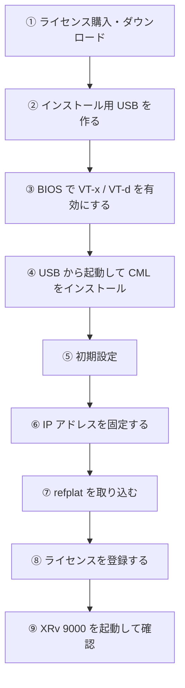

# CML-Personal をベアメタルで構築する

XR（IOS XRv 9000）を6台以上動かすために、中古のワークステーションを CML 専用機にして、CML-Personal をベアメタルで入れたときの記録です。手順と、実際にハマったところをまとめています。

!!! info "このページで載せていない情報"
    パスワード、ライセンスの登録トークン、Smart Account / Virtual Account の番号、自宅のネットワークの IP アドレスやルータの機種、機器のシリアル番号、SSH の鍵の指紋などは載せていません。IP アドレスは `<CML の IP>` のように置き換えています。refplat などのイメージファイルも配布していません。

## 環境

| 項目 | 内容 |
| --- | --- |
| 本体 | HP Z8 G4 Workstation（中古） |
| CPU | Xeon Gold 6136 × 2（合計 24コア / 48スレッド、3.0GHz） |
| メモリ | 128GB（32GB × 4枚、CPU ごとに2枚ずつ） |
| ストレージ | SSD 512GB ＋ HDD 2TB |
| GPU | Quadro P4000（初期設定の画面表示用） |
| CML | CML-Personal 2.10.1（ベアメタル） |
| refplat | refplat_p-20260409-fcs |

ベアメタルは、パソコンに Windows や VMware を入れず、**CML を直接インストールする**方式です。入れたあとは CML 専用機になり、操作はすべて普段のパソコンのブラウザから行います。

```
VMware で動かす場合：パソコン → Windows → VMware → CML → ルータ
ベアメタル　　　　　：パソコン → CML → ルータ
```

## 全体の流れ



## ① ライセンス購入・ダウンロード

- CML-Personal を Cisco Learning Network Store で購入する
- ダウンロードは、Learning Network Store の **My Account → My Orders → 注文の「Download」** から入る

ダウンロードするのは次の2つ。

| ファイル | 中身 | 注意 |
| --- | --- | --- |
| CML 本体の **ベアメタル用 ISO**（`cml2_p_2.10.x-...-iso.zip`） | CML のインストーラー | OVA は VMware 用なので使わない |
| **refplat の fcs**（`refplat_p-YYYYMMDD-fcs-iso.zip`） | XRv 9000、IOL、IOSv などのイメージ | supplemental（SD-WAN など）と ISE は SP の勉強には不要 |

!!! warning "ハマったところ：2.10.1 のページに refplat がない"
    2.10.1 のような修正版（パッチ版）のページには、CML 本体しか置かれていなかった。refplat は**元のリリース（2.10.0）のページ**にある。refplat は CML の細かい版に関係なく使えるので、2.10.0 のものを 2.10.1 で使って問題なかった。

## ② インストール用 USB を作る

1. CML 本体の zip を解凍して、中の `.iso` を取り出す
2. **Rufus** で、USB メモリに ISO を書き込む（デバイスに USB メモリ、ブートの種類に `.iso` を選んで「スタート」）

!!! warning "ハマったところ：ISO をコピーしても起動できない"
    最初、エクスプローラーで ISO を USB メモリにコピーしようとして「ファイルが大きすぎます」と言われた。USB メモリが FAT32（1ファイル 4GB まで）だったため。そもそも ISO はコピーではなく、**Rufus で書き込む**必要がある。Rufus がファイルシステムも作り直してくれる。

refplat は起動には使わないので、Rufus は不要。あとでネットワーク経由で送る（⑦）。

## ③ BIOS で VT-x / VT-d を有効にする

CML の中のルータは仮想マシンとして動くので、**ベアメタルでも CPU の仮想化機能（VT-x）が必要**。中古機は無効になっていることがある。

HP Z8 G4 の場合：

1. 起動直後に **F10** を連打して BIOS の設定画面に入る
2. **Security → System Security** を開く
3. **Virtualization Technology (VTx)** と **Virtualization Technology for Directed I/O (VTd)** にチェック
4. F10 で保存して終了

!!! warning "ハマったところ：Advanced の中にはない"
    最初 Advanced → System Options を探したが、そこには VT-x はなかった。Z8 G4 では **Security** の中にある。Advanced → System Options の「SATA Controller RAID Mode」などは触らないこと。

VT-x が無効のまま進むと、初期設定の途中で `There is no CPU hardware virtualization available.` と出る。このときは「Continue anyway」ではなく「Halt」を選び、BIOS を直してから起動し直す。

## ④ USB から起動して CML をインストール

1. USB メモリを挿して電源を入れ、**F9** を連打して起動するデバイスのメニューを出す（HP の場合）
2. USB（UEFI と付いているほう）を選ぶ
3. メニューの「**Install CML**」を選ぶ
4. 書き込みが終わると自動で再起動する

起動中に紫の画面に `hp_bioscfg: ACPI-package does not have enough elements` や `ACPI BIOS Error (bug)` といった文字が出るが、HP の BIOS と Linux の相性で出るメッセージで、動作には影響しなかった。

## ⑤ 初期設定

| 画面 | 選んだもの |
| --- | --- |
| 構成の種類 | Standalone |
| ホスト名 | 好きな名前 |
| refplat（Reference Platform）の確認 | **Continue anyway**（あとで取り込む） |
| システム管理者アカウント | Cockpit（`https://<CML の IP>:9090`）用。ユーザー名とパスワードを決める |
| 初期ユーザー | CML の画面（`https://<CML の IP>`）用。システム管理者とは別のパスワード |
| ネットワーク | DHCP（ルータ側で固定する。⑥） |
| オプションのサービス | OpenSSH（ポート 1122）と MCPServer をオン。PATty はオフ |

アカウントは2つある。

| アカウント | 入れる画面 | 使いどころ |
| --- | --- | --- |
| システム管理者 | Cockpit（ポート 9090）、SSH（ポート 1122） | CML 本体の管理、refplat の取り込み |
| 初期ユーザー | CML の画面（ポート 443） | ラボを作る |

!!! danger "一番ハマったところ：合っているはずのパスワードで入れない"
    初期設定で決めたパスワードで、Cockpit にもコンソールにもログインできなかった。原因は**キーボード配列**。CML の画面は英語（US）配列のキーボードとして動いているので、日本語キーボードで**記号**を打つと、キーの刻印と違う記号が登録される。結局、2回入れ直した。

    - パスワードは**英大文字・小文字・数字だけ**にする（初期設定で「記号を入れて」と警告が出るが、そのまま進めてよい）
    - 数字は**上の段の数字キー**で打つ（テンキーは Num Lock の状態で入らないことがある）
    - **Caps Lock** がオフか確認する
    - 心配なら、文字が見える入力欄に一度パスワードを打って、表示を確かめてから消す
    - システム管理者のユーザー名を初期値（`sysadmin`）から変えた場合は、その名前を必ずメモする

    初期設定が終わったら、普段のパソコン（Windows）から操作するので、記号の問題はなくなる。

## ⑥ IP アドレスを固定する

DHCP のままだと、再起動で IP アドレスが変わることがある。**ルータの DHCP 固定割当**で、CML 専用機に毎回同じ IP アドレスを渡すようにした。CML 側の設定を変えずにすむので、設定を間違えてつながらなくなる心配がない。

## ⑦ refplat を取り込む

USB を使わず、普段のパソコンからネットワーク経由で送った。

!!! danger "ハマったところ：何度送っても 6.8GB で止まる"
    最初はシステム管理者のホームフォルダーに送っていたが、何度やっても 15GB の ISO が 6.8GB で切れていた。`df -h` で見ると、ホームフォルダーがある区画（`/`）は **10GB 弱しかなかった**。CML は SSD を区画に分けていて、イメージやラボのデータは **`/var`（数百 GB）**に入る作り。送り先を `/var` の中に変えたら解決した。

    ```
    df -h
    ```

    ```
    Filesystem                Size  Used Avail Use% Mounted on
    /dev/mapper/vg00-lv_root  9.8G  2.6G  6.8G  28% /
    /dev/mapper/vg00-lv_var   460G  7.2G  434G   2% /var
    ```

手順：

**1. 普段のパソコン（PowerShell）から `/var/tmp` に送る**

```
scp -O -P 1122 "<ISO の場所>\refplat-YYYYMMDD-fcs.iso" <システム管理者のユーザー名>@<CML の IP>:/var/tmp/refplat_images.iso
```

- `-P 1122`：システム管理者用の SSH（初期設定で OpenSSH をオンにしたもの）
- `-O`：Windows の scp は新しい送り方（SFTP）を使うので、昔の送り方に切り替える。付けないと途中で止まった
- 送り終わるまで（100% になってプロンプトに戻るまで）、CML 側では何もしない

**2. 届いたか確認して、受け取り場所に移す**（Cockpit の「ターミナル」で）

```
ls -lh /var/tmp/refplat_images.iso
sudo mv /var/tmp/refplat_images.iso /var/local/virl2/dropfolder/
```

ファイル名は必ず `refplat_images.iso` にする。

**3. 取り込む**

```
sudo /usr/share/cockpit/virl2/copy-refplat-iso-to-disk.sh
```

Cockpit の CML2 → Maintenance の「Copy Refplat ISO」ボタンでも同じことができる（Cockpit 右上の「管理アクセス」が有効になっている必要がある）。

**4. 確認する**

```
sudo ls /var/lib/libvirt/images/virl-base-images/
```

`iol`、`iosv`、`iosxrv9000` などが並んでいれば成功。

!!! tip "途中までのファイルを取り込むと"
    6.8GB の ISO を取り込んだときは、イメージがアルファベット順に `csr1000v` あたりまでしかコピーされず、XR や IOL がノードの一覧に出てこなかった。ノードが足りないときは、まず ISO のサイズを確かめる。

## ⑧ ライセンスを登録する

1. Learning Network Store の **My Orders → 注文 → View license(s)** で、登録トークン（Registration Token）をコピーする
2. CML の画面の **Tools → Licensing → REGISTER...** にトークンを貼り付ける
3. Registration Status が **Registered**、License Authorization Status が **Authorized** になれば完了

登録が終わったあとに Product Configuration を開くと「登録後は変更できない」と赤いメッセージが出るが、問題ない。

## ⑨ XRv 9000 を起動して確認

XRv 9000 を6台置いて、同時に起動できた。

| 項目 | 値 |
| --- | --- |
| XRv 9000 1台の割り当て | 4 vCPU、約 20GB |
| 6台の割り当ての合計 | 24 vCPU、約 120GB |
| 実際に使っていたメモリ | 約 87GB（空き 約 38GB） |
| CPU の負荷 | 約 7%（48 CPU 中） |

メモリの割り当ては 128GB に対してほぼいっぱいなので、CE などは軽い IOL を足していく。

## 運用のメモ

- シャットダウンは、Cockpit から行うか、電源ボタンを**1回だけ短く押す**（長押ししない）
- 初期設定が終わったら、モニターとキーボードは外してよい。電源ケーブルと LAN ケーブルだけで動く
- 起動のたびに紫の画面にエラーのような文字が出るが、正常

## 参考にした記事

[CMLの導入と使い方](../articles/cml-setup.md) にまとめた記事、特に次の2つを参考にした。

- [Intel N97のミニPCを買った話（ついでにCML2.8 Free Tierをベアメタルにインストール）（Qiita、ecodrive 氏）](https://qiita.com/ecodrive/items/5e69c74ad195804fff50)
- [Cisco Modeling Labs を購入・初期構築して試す（Qiita、suzuyui 氏）](https://qiita.com/suzuyui/items/f2ed1738eaa1c8f64408)
- [Copy Refplat ISO to Disk（Cisco Modeling Labs ドキュメント）](https://developer.cisco.com/docs/modeling-labs/copy-refplat-iso-to-disk/)
