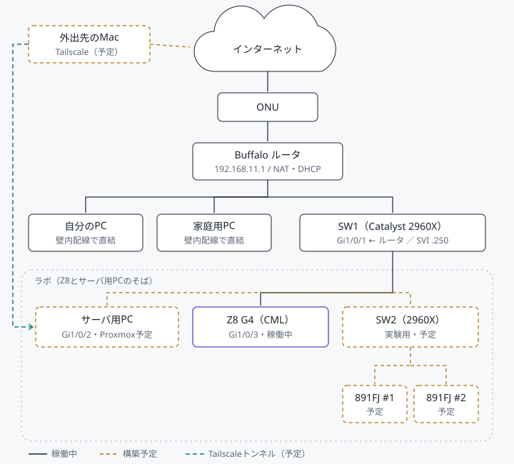
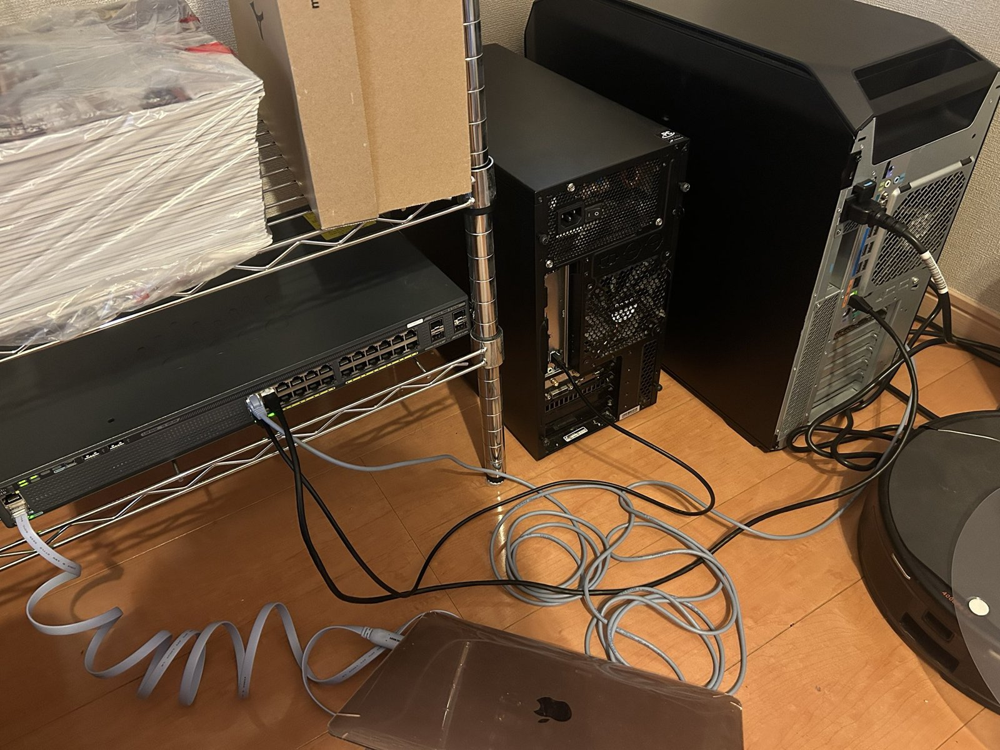

# 自宅ラボ構築ログ

Buffalo のルータの下に Catalyst 2960X を置き、CML（Z8 G4）と Proxmox でネットワークの検証環境を作っていく記録です。構成図・VLAN の計画・作業の進み具合をまとめています。日ごとの作業は [勉強記録](../study-log/index.md) に、うまくいかなかったことは [トラブルシューティング](../troubleshooting/index.md) に書いています。

## いまの状況

| 項目 | 状態 | 内容 |
| --- | --- | --- |
| SW1 の設置 | 完了 | Buffalo の下に 2960X を設置し、CML まで通信できることを確認（2026-11-22） |
| Proxmox・VyOS | 次にやる | サーバ用PC に Proxmox を入れ、VyOS の VM を動かす |
| VLAN 分割・Tailscale | 計画 | VLAN 10・20・99 を作り、外出先からは Tailscale で入る |

## 構成図

実線は動いているもの、点線はこれから作るものです。

- ONU からは壁の中の配線で各部屋に直接つながっているので、ルータから自分の PC・家庭用 PC・ラボの SW1 へ1本ずつ引いている
- ラボの機器（SW1、Z8、サーバ用 PC）は同じ場所にまとめて置いている
- 外出先からはルータのポートを開けず、Tailscale だけで入る予定

## 設置の様子

左が SW1（2960X）、まん中がサーバ用 PC（Proxmox 予定）、右が Z8 G4（CML）。SW1 と Z8 をつないだ直後の状態。

## VLAN の計画

家の LAN は Buffalo がそのまま受け持ち、ラボの VLAN は Proxmox 上の VyOS がルーティングする。今は VLAN 1 だけで動かしている。

| VLAN | 用途 | ネットワーク | ゲートウェイ | 状態 |
| --- | --- | --- | --- | --- |
| 1 | 家の LAN | 192.168.11.0/24 | Buffalo | 動いている |
| 10 | ラボのサーバ（TACACS+、Syslog、NetBox など） | 192.168.10.0/24 | VyOS | 計画 |
| 20 | ラボの実験（891FJ、CML の外部接続） | 192.168.20.0/24 | VyOS | 計画 |
| 99 | 管理（スイッチ、Proxmox、CML、Tailscale） | 192.168.99.0/24 | VyOS | 計画 |

!!! note "サーバと実験を分ける理由"
    実験の VLAN でループなどを起こしても、TACACS+ や Syslog のサーバは止まらない。管理の VLAN を分けておくと、スイッチや Proxmox の管理画面に入れる経路をしぼれる。

## SW1 のポートの割り当て

| ポート | つないでいるもの | いま | 最終的に |
| --- | --- | --- | --- |
| Gi1/0/1 | Buffalo ルータ | access VLAN 1 | access VLAN 1（変えない） |
| Gi1/0/2 | サーバ用 PC（Proxmox） | access VLAN 1 | trunk 1,10,20,99（native 99） |
| Gi1/0/3 | Z8 G4（CML） | access VLAN 1 | trunk 20,99（native 99） |
| Gi1/0/4 | SW2 | 使っていない | trunk 20,99（native 999） |
| Vlan1 | SW1 の管理用 IP | 192.168.11.250 | VLAN 99 に移す |

- Buffalo（家庭用のモデル）はタグ VLAN に対応していないので、ルータ向けのポートは access にする
- trunk のタグは、スイッチではなく受け取る側（Proxmox の VLAN aware bridge や、Z8 の VLAN サブインタフェース）で外す

## 作業の記録

| 日付 | 内容 |
| --- | --- |
| [2026-11-22](../study-log/2026-11-22.md) | 2960X のパスワードリカバリ、SW1 の設置、CML への疎通確認（Z8 の LAN ポートの挿し間違い） |
| 2026-11-20 | 構成の検討。VLAN を4つに分ける計画、Tailscale で外から入る方針、Proxmox に載せたいサーバを決めた |

## 次にやること

- [x] SW1 を Buffalo の下に置き、CML まで疎通を確認する
- [ ] サーバ用 PC の BIOS で、仮想化支援と Wake on LAN を有効にする
- [ ] Proxmox を入れ、管理画面（:8006）に入れることを確認する
- [ ] VyOS の VM を作り、まずは VLAN 1 で動かす
- [ ] VLAN 10・20・99 を作り、Gi1/0/2 と Gi1/0/3 を trunk に変える
- [ ] Tailscale の LXC を立て、外出先の Mac から入れるようにする
- [ ] Syslog＋Grafana、Oxidized から順にサーバを足す
- [ ] SW2 と 891FJ×2 を実験用の VLAN に組み込む
