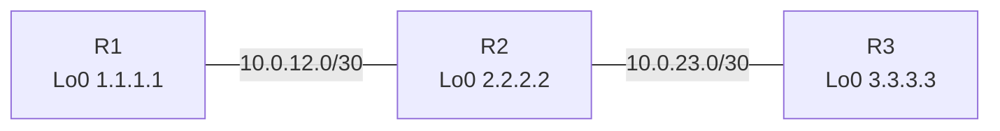

# LDPの基本（IOS XR）

!!! info "この記事の環境"
    - 検証環境: CML（IOS XR × 3）
    - IGP: IS-IS
    - アドレスはすべて検証用（ドキュメント用・プライベート）です

## ゴール

- IOS XR で LDP ネイバーを確立する
- ループバック宛のラベルが配布され、LFIB に載ることを確認する

## トポロジ



## 設定

=== "R1"

    ```text
    mpls ldp
     router-id 1.1.1.1
     interface GigabitEthernet0/0/0/0
     !
    !
    ```

=== "R2"

    ```text
    mpls ldp
     router-id 2.2.2.2
     interface GigabitEthernet0/0/0/0
     !
     interface GigabitEthernet0/0/0/1
     !
    !
    ```

=== "R3"

    ```text
    mpls ldp
     router-id 3.3.3.3
     interface GigabitEthernet0/0/0/0
     !
    !
    ```

## 確認

```text
RP/0/RP0/CPU0:R1# show mpls ldp neighbor brief
（ここに CML で取った出力を貼る）
```

```text
RP/0/RP0/CPU0:R1# show mpls forwarding
（ここに CML で取った出力を貼る）
```

## わざと壊してみる

!!! warning "障害注入"
    R2 の片側インターフェースだけ LDP を外すと何が起きるか？
    （観察したこと・原因・切り分けコマンドを書く）

## ハマったポイント

- （例）IOS XR は `commit` しないと設定が反映されない

## まとめ

- （学んだことを3行で）
