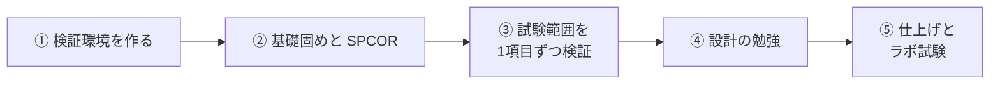

# CCIE SP 合格までのロードマップ

CCIE Service Provider に合格するまでに、自分がやることをまとめたチェックリストです。終わったものにチェックを入れて更新していきます。使う本や教材は [合格者が使った教材](../articles/ccie-study-resources.md) と [参考書一覧](../articles/books.md) にまとめています。

## 試験の形

| 試験 | 内容 |
| --- | --- |
| SPCOR（350-501） | 筆記の資格試験（120分）。CCIE SP のラボを受ける前に合格が必要。CCNP SP のコア試験も兼ねる |
| CCIE SP ラボ試験 v5.1 | 8時間の実技。**Design（設計、3時間）** と **DOO（構築・運用・最適化、5時間）** の2つに分かれている |

②〜④は順番どおりでなくてよく、並行して進める。

## ① 検証環境を作る

XR を6台以上動かせる CML の専用機を用意する。

- [x] CML Free を自宅の PC に入れて、IOSv でラボを組む
- [x] XR を動かせるワークステーションを用意する（CML 専用機、ベアメタルで運用）
- [x] CML-Personal のライセンスを買う（XR を使うのに必要）
- [x] CML のベアメタル用インストール ISO と refplat ISO をダウンロードする
- [x] BIOS で VT-x / VT-d を有効にする
- [ ] メモリのテスト（memtest86）を流す
- [x] CML をベアメタルでインストールし、IP アドレスを固定する（ルータの DHCP 固定割当）
- [x] refplat（ルータのイメージ）を取り込む
- [x] CML-Personal のライセンスを登録する
- [x] XRv 9000 を6台同時に起動する
- [ ] XRv 9000 で OSPF・BGP が動くことを確認する
- [ ] CML Free で作ったラボ（YAML）を新しい CML に移す
- [x] Wake on LAN で電源を入れられるようにする
- [ ] （あとで）外出先から VPN 経由でラボにつなげるようにする

構築の手順とハマりどころは [CML-Personal をベアメタルで構築する](../about/cml-baremetal.md) にまとめた。

## ② 基礎固めと SPCOR

- [ ] 『MPLS Fundamentals』を読み終える（今は第7章の途中）
- [ ] 『SPCOR 350-501 Official Cert Guide』を一通り読む
- [ ] SPCOR に合格する
- [ ] （任意）コンセントレーション試験にも合格して CCNP SP を取る

## ③ 試験範囲を1項目ずつ検証する

Cisco Learning Network の CCIE SP v5.1 の試験範囲（Exam Topics）をチェックリストにして、1項目ずつ CML で確かめる。確かめたことは、このサイトの[検証](../verification/index.md)ページに「仮説 → 設定 → 確認 → 結果 → 考察」で残す。

- [ ] 試験範囲（Exam Topics）を書き出してチェックリストにする
- [ ] 途中の検証を終わらせる：[OSPF で広報される経路](../verification/ospf/advertised-routes.md)、[CE から受けた経路が PE の VRF に入るまで](../verification/l3vpn-ce-route-to-vrf.md)

分野ごとの検証（どれも IPv4 と IPv6 の両方で確かめる）：

| 分野 | 主な内容 | 状態 |
| --- | --- | --- |
| IGP | OSPF、IS-IS、経路の再配布、高速収束 | 着手 |
| BGP | iBGP / eBGP、ルートリフレクタ、ポリシー制御、ベストパス | 着手 |
| MPLS | LDP、RSVP-TE | 未着手 |
| Segment Routing | SR-MPLS、TI-LFA、SR-TE、SRv6 | 未着手 |
| L3VPN | VRF、RD / RT、PE-CE ルーティング、インター AS | 着手 |
| L2VPN | VPWS、VPLS、EVPN | 未着手 |
| マルチキャスト | PIM、マルチキャスト VPN（mVPN） | 未着手 |
| QoS | 分類・マーキング、キューイング、MPLS の QoS | 未着手 |
| セキュリティ | コントロールプレーンの保護、RTBH、BGP Flowspec | 未着手 |
| 自動化・運用 | NETCONF / YANG、テレメトリ | 未着手 |

使う教材：

- [ ] CCIE SP v5.1 の無料ワークブック（Andrew Ohanian 氏）を順番に解く
- [ ] わからないところは IOS XR の Configuration Guide で確かめる

## ④ 設計の勉強（Design モジュール対策）

Design は3時間、英語の長い要件を読んで設計を選ぶ形式。合格者の体験記では「英語を読み続けるのがきつい」と書かれていた。

- [ ] 設計の本を1冊読む（『Definitive MPLS Network Designs』など）
- [ ] Cisco Live の SP 設計の資料を読む
- [ ] 英語の技術文書を毎日少し読んで、長文に慣れる

## ⑤ 仕上げとラボ試験

- [ ] 8時間通しで解く練習をする（ワークブックの総合問題）
- [ ] Cisco の有料 Practice Lab で、本番の画面と環境に慣れる
- [ ] 英字キーボードで設定を打つ練習をする（本番は英字配列）
- [ ] ラボ試験を予約する（予約してしまうと勉強のペースが決まる）
- [ ] ラボ試験を受ける（1回目は本番の形式に慣れるつもりで受ける）

## 続けること

- 本で読んだことは、必ず CML で動かして確かめる（読む → 動かす）
- 疎通しただけで満足しない。show で**要件どおりか**を確認するクセをつける
- 最後に頼るのは設定ガイドと Command Reference
- 勉強したことは[勉強記録](../study-log/index.md)に日付ごとに残す

!!! warning "使わないもの"
    「本番の問題」をうたう dump（問題の横流し）サイトは使わない。使うと資格の取り消しや受験禁止になることがある。
