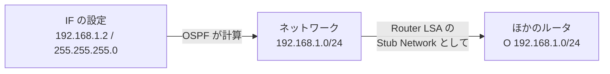

# OSPF と BGP の「広報」の違い（IF を指定するか、経路を指定するか）

OSPF も BGP も「経路を広報する」と言うが、**何を指定して広報するか**がまったく違う。

- 調べたきっかけ：[勉強記録 2026-11-19](../study-log/2026-11-19.md)

!!! abstract "一言でまとめると"
    - **OSPF**：**IF** を選ぶと、その IF のネットワークが**自動で**広報される
    - **BGP**：ルーティングテーブルにある**経路**の中から、広報するものを `network` で**選ぶ**

## 比べてみる

| | OSPF | BGP |
| --- | --- | --- |
| 指定するもの | **IF**（`interface GigabitEthernet0/0/0/1`） | **経路**（`network 192.168.1.0/24`） |
| 広報されるもの | その IF の IP アドレスとマスクから計算したネットワーク | 書いたプレフィックス（ルーティングテーブルに同じ形であれば） |
| ネットワーク番号を自分で書くか | 書かない（自動で計算） | 書く |
| 指定したら、ほかに何が起きるか | その IF で **Hello を送る**（ネイバーを探す） | 何も起きない（ネイバーは `neighbor` で別に指定する） |
| ネイバーの指定 | IF を指定すると、その先のルータと自動でネイバーになる | `neighbor <IP>` と `remote-as` で、相手を1つずつ書く |

## OSPF：IF を指定する

### IF の「ネットワーク」とは

IF に IP アドレスを付けるときは、必ずマスクも付ける。

```
interface GigabitEthernet0/0/0/1
 ipv4 address 192.168.1.2 255.255.255.0
```

| | 値 | 意味 |
| --- | --- | --- |
| IP アドレス | 192.168.1.2 | ルータ自身の住所 |
| **ネットワーク** | **192.168.1.0/24** | この IF の先にいる、192.168.1.0〜192.168.1.255 の範囲 |

この範囲が「**IF のネットワーク**」。

### OSPF で IF を有効にすると

```
router ospf 1
 area 0
  interface GigabitEthernet0/0/0/1
```

この1行で、OSPF は次の2つをする。

1. **その IF で Hello を送る**：つながった先にルータがいれば、ネイバーになる
2. **その IF のネットワークを、ほかのルータに教える**：「R1 の先に 192.168.1.0/24 があるよ」← これが「広報」

ネットワーク番号は自分で書かなくても、**IF の IP アドレスとマスクから、OSPF が自動で計算する**。



[物理 IF だけで有効にしたときの検証](../verification/ospf/physical-if-only.md) で、R1 の G0/0/0/1 を OSPF に入れたら、R1 の Router LSA に次の行が増え、R2 に `O 192.168.1.0/24` が載った。

```
Link connected to: a Stub Network
 (Link ID) Network/subnet number: 192.168.1.0
 (Link Data) Network Mask: 255.255.255.0
```

!!! tip "Hello は送らずに、広報だけしたいとき"
    PC 側など、先にルータがいない IF は `passive enable` にする。ネットワークは広報したまま、Hello だけ止まる（[passive のトラブルシューティング](../troubleshooting/ospf-passive.md)）。ループバックは、もともと Hello を送らない。

## BGP：経路を指定する

```
router bgp 65000
 address-family ipv4 unicast
  network 2.2.2.2/32
```

- `network` の後ろに書いたプレフィックスが、BGP で相手に広報される経路になる
- ただし、そのプレフィックスが**ルーティングテーブルに完全に同じ形（長さも同じ）で載っている**ことが条件
- `network` は経路を新しく作るコマンドではなく、**ルーティングテーブルにある経路の中から、広報するものを選ぶ**コマンド

| network に書いたもの | ルーティングテーブル | 広報されるか |
| --- | --- | --- |
| `2.2.2.2/32` | `L 2.2.2.2/32`（ループバック） | される |
| `192.168.23.0/30` | `C 192.168.23.0/30` | される |
| `2.2.2.0/24` | `2.2.2.2/32` しかない | **されない**（長さが違う） |
| `10.0.0.0/8` | 載っていない | **されない** |

### 広報されるまでの流れ（IOS XR の eBGP）


- IOS XR の eBGP は、`route-policy` を `in` と `out` の両方に入れないと、経路を**1つもやりとりしない**
- `network` のほかに、`redistribute connected` や `redistribute ospf` で、ほかのプロトコルの経路をまとめて BGP に入れる方法もある

## なぜ違うのか

| | OSPF（IGP） | BGP（EGP） |
| --- | --- | --- |
| 何のためのプロトコルか | 自分の網（AS）の中の**つながり方**を全員で共有する | AS と AS の間で、**どの経路を外に見せるか**を選んでやりとりする |
| 広報の考え方 | つながっている IF は、全部知らせるのが基本 | 見せる経路を、1つずつ選ぶ（勝手に広報しない） |

OSPF は「網の中の地図を作る」ので、IF の情報をそのまま配る。BGP は「外にどの経路を見せるか」を決めるので、経路を自分で選んで指定する。

## 関連

- [OSPF](ospf/index.md)、[BGP](bgp/index.md)
- [勉強記録 2026-11-19](../study-log/2026-11-19.md)（IOS XR の eBGP でつまずいたところ）
