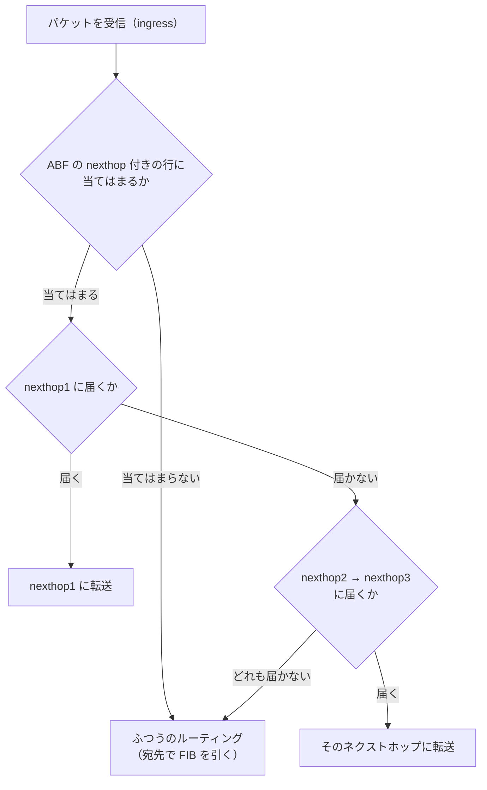

# ABF（ACL-Based Forwarding）

ABF は **ACL-Based Forwarding（ACL ベースの転送）** の略で、IOS XR で使うポリシーベースルーティング（PBR）のしくみ。ACL に当てはまったパケットだけを、ルーティングテーブルとは別のネクストホップに送る。

## IOS の PBR との違い

| | IOS / IOS XE | IOS XR |
| --- | --- | --- |
| 名前 | PBR（Policy Based Routing） | ABF（ACL-Based Forwarding） |
| 書く場所 | route-map で `match` と `set ip next-hop` | **ACL の行の中に `nexthop` を書く** |
| インターフェースへの適用 | `ip policy route-map` | `ipv4 access-group ... ingress` |

## 設定例

送信元が 10.1.1.0/24 のパケットだけ、192.0.2.1 に送る例。

```
ipv4 access-list ABF-TEST
 10 permit ipv4 10.1.1.0/24 any nexthop1 ipv4 192.0.2.1 nexthop2 ipv4 192.0.2.5
 20 permit ipv4 any any
!
interface GigabitEthernet0/0/0/0
 ipv4 access-group ABF-TEST ingress
!
commit
```

- ネクストホップは最大3つ（`nexthop1`〜`nexthop3`）書ける。前のものが使えないと次を使う
- ネクストホップに VRF を指定して、別の VRF に送り込むこともできる（`nexthop1 vrf <VRF名> ipv4 ...`）
- **受信側（ingress）**のインターフェースに適用する

!!! warning "最後の permit any any を忘れない"
    ACL の最後には暗黙の deny がある。20 行目の `permit ipv4 any any` がないと、10.1.1.0/24 以外のパケットは全部捨てられる。ABF の ACL はフィルタとしても効く。

## ルーティングテーブルとどちらが優先されるか

**ABF に当てはまったパケットは ABF が優先**される。受信したときに ACL（ABF）が確認され、宛先で FIB を引くより先に転送先が決まるため。



- nexthop に届かないとき（ルートがない、インターフェースが落ちている）は、次の nexthop、最後はふつうのルーティングに戻る。ABF が使えないからといって捨てられるわけではない
- ABF は**ルーティングテーブルに何も書き込まない**。転送の直前に行き先を差し替えているだけ。経路制御（コントロールプレーン）ではなく、転送（データプレーン）の段階のしくみ

!!! tip "トラブルのときの注意"
    - `show route` を見ても、ABF で曲げられた行き先は出てこない
    - 「ルーティングテーブルではこっちに行くはずなのに、違うところに行く」ときは、受信インターフェースに ABF の ACL が付いていないかを疑う
    - ルータ自身が送り出すパケット（OSPF・BGP のパケット、ルータからの ping）には効かない。受信したパケットだけが対象

!!! note "自分のメモ（2026-10-22）"
    ABF に当てはまったパケットは、ルーティングテーブルより ABF が優先される。ACL の確認が FIB を引くより先に行われるから。ルーティングテーブルには出てこないので、トラブルのときは ACL も確認する。
