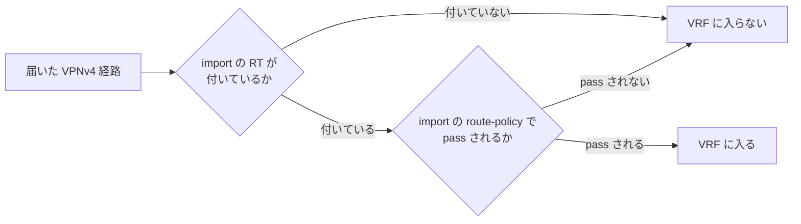

# VRF

VRF（Virtual Routing and Forwarding）の設定と動きについてのメモです。L3VPN で PE に作る VRF を中心にまとめています。

## IOS XR：import の RT とルートポリシーは AND で効く

IOS XR の VRF では、ほかの PE から届いた VPNv4 の経路を取り込む条件として、**import の route-target** と **import の route-policy** の両方を設定できる。

```
vrf CUST-A
 address-family ipv4 unicast
  import route-policy RP-CUST-A-IN
  import route-target
   65000:100
  !
  export route-target
   65000:100
  !
 !
!
route-policy RP-CUST-A-IN
  if destination in (10.10.0.0/16 le 32) then
    pass
  endif
end-policy
!
commit
```

この2つは **OR ではなく AND** で効く。



- まず RT で「この VRF に取り込む候補か」が決まる
- その候補を、route-policy でさらにふるいにかける
- どちらか片方だけ満たしても VRF には入らない。**RT が一致して、かつ route-policy で pass されたものだけ**が入る

!!! note "自分のメモ（2026-10-20）"
    IOS XR で VRF を設定していて、import の RT と route-policy を両方書けることに気づいた。どちらかに当てはまれば取り込む（OR）のではなく、両方を満たしたときだけ取り込む（AND）ものだと知った。

!!! tip "補足"
    - `import route-target` の下に RT を複数並べた場合、**RT 同士は OR**。どれか1つでも付いていれば候補になる
    - route-policy は経路を落とすだけでなく、取り込むときに属性（Local Preference など）を変えるのにも使える
    - export 側にも `export route-policy` があり、送り出す経路に RT を付け分けたりできる

## 確認に使うコマンド

| コマンド | 何を見るか |
| --- | --- |
| `show vrf CUST-A detail` | VRF に設定した RT（import / export）と route-policy |
| `show bgp vpnv4 unicast rd all <プレフィックス>` | 届いた経路に付いている RT |
| `show bgp vrf CUST-A` | VRF に取り込まれた経路 |
| `show route vrf CUST-A` | VRF のルーティングテーブル |

## 関連ページ

| ページ | 内容 |
|------|------|
| [検証：CE から受けた経路が PE の VRF に入るまで](../../verification/l3vpn-ce-route-to-vrf.md) | L3VPN で、PE の VRF・VPNv4 テーブルに経路が入る順番（検証前） |
| [勉強記録 2026-10-18](../../study-log/2026-10-18.md) | RD・RT・VPN ラベル、VRF と VPNv4 の関係 |
