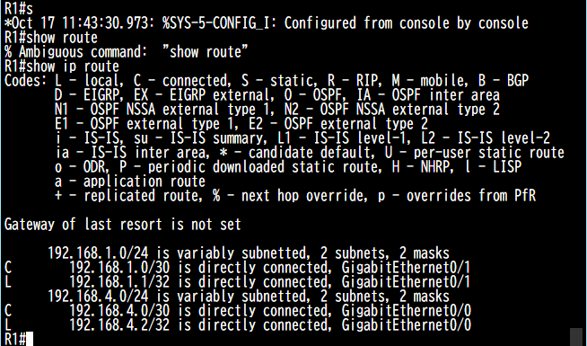

# 2026-10-17 CML Free 導入と show ip route の読み方

## 今日やったこと

- 自宅のPCに CML Free を導入（導入で参考にした資料は[参考記事](../articles/cml-setup.md)にまとめた）
- IOSv でラボを組み、インターフェースにアドレスを設定
- `show ip route` でルーティングテーブルの表示を確認
- ラボ用の便利な設定として `exec-timeout` と `write memory` を確認

## show ip route の L と C

R1 で `show ip route` を実行したときの出力。



R1 は2本のリンクを /30 で設定している。

| インターフェース | 自分のアドレス | ネットワーク |
| --- | --- | --- |
| GigabitEthernet0/1 | 192.168.1.1 | 192.168.1.0/30 |
| GigabitEthernet0/0 | 192.168.4.2 | 192.168.4.0/30 |

- **L（local）**：自分の筐体のインターフェースに割り当てたアドレスそのもの。必ず /32 で表示される
- **C（connected）**：そのインターフェースが直接つながっているネットワークの範囲。対向ルータのアドレスもこの範囲に含まれる

今回は対向との渡りを /30 の P2P にしているので、C はその /30 のネットワーク、L は自分側の1アドレス（/32）として表示されている。/30 は使えるアドレスが2つだけなので、範囲の中には自分と対向の2台しかいない。

`192.168.1.0/24 is variably subnetted, 2 subnets, 2 masks` の行は、192.168.1.0/24 の中に /30（C）と /32（L）の2種類のマスクのルートが入っていることを示している。

## ラボ用の便利な設定

```
line con 0
 exec-timeout 0 0
 logging synchronous
!
write memory
```

- **exec-timeout**：操作がないときにセッションを自動で切るまでの時間。`0 0` でタイムアウトしなくなる（ラボ専用。本番では使わない）
- **logging synchronous**：入力中にログが割り込んでも、打っていたコマンドを表示し直して読みやすくする
- **write memory**：今の設定（running-config）を保存し、再起動しても残るようにする。CML でノードを WIPE すると保存していても消えるので、残したいときは LAB →「Extract Configs」も使う
