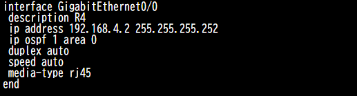
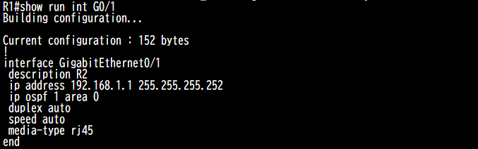

# 2026-10-17 CML Free 導入と show ip route の読み方

## 今日やったこと

- 自宅のPCに CML Free を導入（導入で参考にした資料は[参考記事](../articles/cml-setup.md)にまとめた）
- IOSv でラボを組み、インターフェースにアドレスを設定
- `show ip route` でルーティングテーブルの表示を確認
- IOS と IOS XR の OSPF 有効化方法の違いを確認
- OSPF で広報される経路を確認（ループバックは設定を入れないと広報されない）
- ラボ用の便利な設定として `exec-timeout` と `write memory` を確認

## show ip route の L と C

R1 で `show ip route` を実行したときの出力。


R1 は2本のリンクを /30 で設定している。

| インターフェース | 自分のアドレス | ネットワーク |
| --- | --- | --- |
| GigabitEthernet0/1 | 192.168.1.1 | 192.168.1.0/30 |
| GigabitEthernet0/0 | 192.168.4.2 | 192.168.4.0/30 |

- **L（local）**：自分の筐体のインターフェースに割り当てたアドレスそのもの。必ず /32 で表示される
- **C（connected）**：そのインターフェースが直接つながっているネットワークの範囲。対向ルータのアドレスもこの範囲に含まれる

今回は対向との渡りを /30 の P2P にしているので、C はその /30 のネットワーク、L は自分側の1アドレス（/32）として表示されている。/30 は使えるアドレスが2つだけなので、範囲の中には自分と対向の2台しかいない。

`192.168.1.0/24 is variably subnetted, 2 subnets, 2 masks` の行は、192.168.1.0/24 の中に /30（C）と /32（L）の2種類のマスクのルートが入っていることを示している。

## ラボ用の便利な設定

```
line con 0
 exec-timeout 0 0
 logging synchronous
!
write memory
```

- **exec-timeout**：操作がないときにセッションを自動で切るまでの時間。`0 0` でタイムアウトしなくなる（ラボ専用。本番では使わない）
- **logging synchronous**：入力中にログが割り込んでも、打っていたコマンドを表示し直して読みやすくする
- **write memory**：今の設定（running-config）を保存し、再起動しても残るようにする。CML でノードを WIPE すると保存していても消えるので、残したいときは LAB →「Extract Configs」も使う

## OSPF の有効化：IOS と IOS XR の違い

R1 の Gi0/0 の設定。インターフェースに直接 `ip ospf 1 area 0` を書いて、OSPF を有効にしている。



IOS と IOS XR では、OSPF を有効にするインターフェースの指定のしかたが違う。

=== "IOS（インターフェースで指定）"

    ```
    interface GigabitEthernet0/0
     ip ospf 1 area 0
    ```

=== "IOS（network コマンドで指定）"

    ```
    router ospf 1
     network 192.168.4.0 0.0.0.3 area 0
    ```

=== "IOS XR"

    ```
    router ospf 1
     area 0
      interface GigabitEthernet0/0/0/0
      !
     !
    !
    commit
    ```

- **IOS**：インターフェース側で `ip ospf <プロセス> area <エリア>` を書くか、`router ospf` 配下で `network` コマンドを使ってアドレス範囲で指定する。どちらでもよい
- **IOS XR**：`router ospf` → `area` の配下に、有効にするインターフェースを並べる方式だけ。`network` コマンドはない。設定は `commit` するまで反映されない

IOS XR の方式は、どのエリアにどのインターフェースが属しているかが設定を見ただけでわかるのが利点。IOS の `network` コマンドはワイルドカードの範囲指定なので、意図しないインターフェースまで OSPF に入ってしまうことがある。

## OSPF で広報されるのは「OSPF を有効にした IF のネットワーク」だけ

### やったこと

R1 の物理インターフェース（Gi0/0、Gi0/1）に `ip ospf 1 area 0` を設定して、OSPF で経路が広報されるか確認した。



### 学んだこと

- インターフェースに OSPF の設定を入れると、そのインターフェースのネットワーク（Gi0/1 なら 192.168.1.0/30）が OSPF で広報される
- 逆に、OSPF の設定を入れていないインターフェースのネットワークは広報されない。今回はループバックに設定を入れていなかったので、ループバックのアドレスは他のルータに届いていなかった
- ループバックも広報したいときは、ループバックのインターフェースにも OSPF の設定を入れる

```
interface Loopback0
 ip ospf 1 area 0
```

!!! note "補足"
    - OSPF で広報されるのは IP アドレスそのものではなく、そのインターフェースのネットワーク（プレフィックス）
    - ループバックは、サブネットマスクを /24 などにしていても、OSPF では /32 のホストルートとして広報されるのが初期動作。設定どおりのマスクで広報したいときは、ループバックに `ip ospf network point-to-point` を入れる
