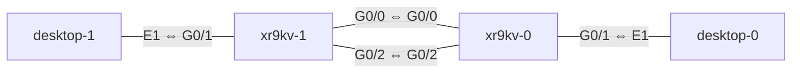

# 2026-10-23 CML 専用機の完成と、Desktop ノードの IP 設定

## 今日やったこと

- CML 専用機（HP Z8 G4）に CML-Personal 2.10.1 をベアメタルで入れて、XRv 9000 を動かせるようにした（手順は [CML-Personal をベアメタルで構築する](../about/cml-baremetal.md) にまとめた）
- XRv 9000 の RAM を減らせるか試した（16GB では起動しなかった）
- XR 2台と Desktop 2台で最初のラボを組み、Desktop（Linux）に IP アドレスを設定した

## ラボ構成

XR 同士を2本でつなぎ、それぞれの先に PC 役の Desktop を置いた。2本あるので、あとで ECMP や TI-LFA の切り替えも試せる。



| 機器 | インターフェース | IP アドレス |
| --- | --- | --- |
| desktop-1 | E1（中では `eth1`） | 192.168.1.10/24、ゲートウェイ 192.168.1.1 |
| xr9kv-1 | G0/0/0/1 | 192.168.1.1/24 |
| xr9kv-1 ⇔ xr9kv-0 | G0/0/0/0 | 10.0.0.1/30 ⇔ 10.0.0.2/30 |
| xr9kv-1 ⇔ xr9kv-0 | G0/0/0/2 | 10.0.1.1/30 ⇔ 10.0.1.2/30 |
| xr9kv-0 | G0/0/0/1 | 192.168.2.1/24 |
| desktop-0 | E1（中では `eth1`） | 192.168.2.10/24、ゲートウェイ 192.168.2.1 |

## XRv 9000 の RAM は 16GB では足りなかった

6台を同時に動かしたらメモリが 94% になったので、XR 1台あたりの RAM を 20GB（20480 MiB）から 16GB（16384 MiB）に減らした。すると、XR が起動の途中で止まった。

- 状態が 30分以上たっても **STARTED** のまま（BOOTED にならない）
- CPU の使用率が **0%** のまま
- コンソールは `Finished SELinux init for /dev service loading.` の行で止まっていた

RAM を **20480** に戻したら、正常に BOOTED になった。CML に入っている **IOS XR 9000v 26.1.1** は、16GB では起動できないと考えられる。

| RAM | 結果 |
| --- | --- |
| 20480 MiB（初期値） | 起動した |
| 16384 MiB | 起動の途中で止まった |

!!! note "自分のメモ"
    - XR の RAM はノードの SETTINGS → Compute で変えられる。一度起動したノードは、**Wipe しないと**変えられない
    - 標準の定義（Node and Image Definitions）は read-only になっていて、Read Only を外すと編集できる。変えるのは RAM だけにする
    - 128GB の CML 専用機で XR を 20GB にすると、同時に動かすのは **5台くらいまで**が安全。CE などは軽い IOL を使う

### ノードごとの RAM Usage の見方

ノードの一覧で、XR の RAM Usage が **99%**、Desktop が **90%** と赤く表示されていたが、これは**そのノードに割り当てた量のうち、どれだけ使っているか**の割合。

- XR は、割り当てたメモリを起動時にほぼ全部確保する作りなので、99% でも正常
- Linux（Desktop）は、空いているメモリをキャッシュに使うので、高めに出る
- 気にするべきなのは、**CML 全体（専用機）のメモリの空き**。画面下の MEMORY の表示や、ダッシュボードの Free を見る

## Desktop ノード（Linux）に IP アドレスを設定する

CML の Desktop ノードは **Alpine Linux**。初期のアカウントは `cisco` / `cisco`、ホスト名は `inserthostname-here`。CML の構成図の「E1」は、中では `eth1`。

### 流れとコマンド（desktop-1 の例）

```
ip link                                          # ① インターフェースを確認
sudo ip link set eth1 up                         # ② 有効にする
sudo ip addr add 192.168.1.10/24 dev eth1        # ③ IP アドレスを付ける
sudo ip route replace default via 192.168.1.1    # ④ デフォルトゲートウェイ
ip addr show eth1                                # ⑤ 確認
ip route
ping -c 4 192.168.1.1                            # ⑥ 疎通確認
```

- 成功したときは何も表示されない
- `add` ではなく `replace` にすると、すでにデフォルトルートがあっても上書きできる
- `ping` は `-c 4` で4回だけ送る（付けないと Ctrl + C で止めるまで続く）

### 間違えたとき

| やりたいこと | コマンド |
| --- | --- |
| 付けた IP を消す | `sudo ip addr del 192.168.1.10/24 dev eth1` |
| eth1 の IP を全部消す | `sudo ip addr flush dev eth1` |
| デフォルトルートを消す | `sudo ip route del default` |

!!! warning "ハマったところ"
    - `ip -br link` が使えなかった。Desktop の `ip` は **BusyBox** という小さい版なので、`-br` のオプションがない。`ip link`、`ip addr` を使う
    - 最初、desktop-1 に `192.168.1.1` を付けてしまった。ゲートウェイ（XR）用の番号なので、`del` で消して `.10` を付け直した

`ip` コマンドで入れた設定は再起動で消える。残したいときは、ノードの **CONFIG** タブに②〜④を書いておく（変えたら Wipe してから起動）。

### ルータとの対応

| やること | Linux | IOS XR |
| --- | --- | --- |
| 有効にする | `ip link set eth1 up` | `no shutdown` |
| IP を付ける | `ip addr add 192.168.1.10/24 dev eth1` | `ipv4 address 192.168.1.10 255.255.255.0` |
| デフォルトルート | `ip route replace default via 192.168.1.1` | `router static` → `address-family ipv4 unicast` → `0.0.0.0/0 192.168.1.1` |
| IP の確認 | `ip addr` | `show ipv4 interface brief` |
| ルートの確認 | `ip route` | `show route` |

## 次にやること

- XR 2台に IP アドレスを設定して、OSPF を動かす
- desktop-1 から desktop-0 まで ping が届くか確認する
- 2本のリンクで ECMP になるか確かめる
