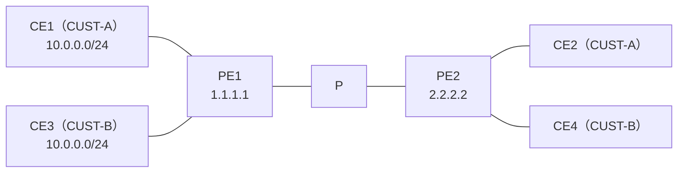
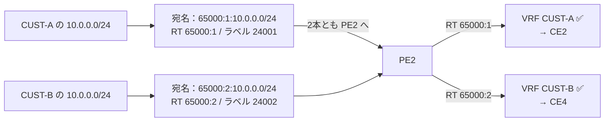
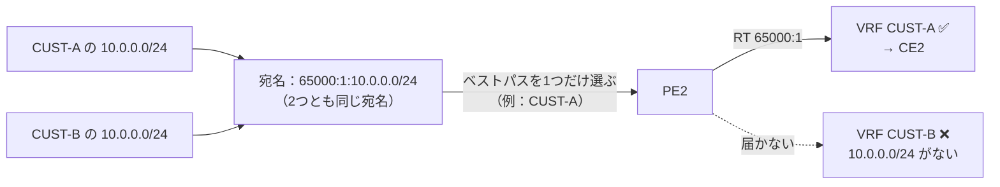

# 2026-10-27 RT があるのに、なぜ RD が必要なのか

## 今日の疑問

CE-PE-P-PE-CE の MPLS L3VPN で、CE-PE 間は eBGP、PE-PE 間は iBGP（VPNv4）で経路を広報する。PE で RT を設定するので、IPv4 の経路はそれで分けられるはず。**それなのに、なぜ RD も設定するのか。**

→ 検証でも確かめる：[RT があるのに、なぜ RD が必要なのか](../verification/l3vpn-why-rd.md)（検証前）

## わかったこと

!!! abstract "一言でまとめると"
    - **RD**：PE から PE へ運ぶ間に、混ざらないようにする
    - **RT**：PE の中で、どの VRF に入れるかを決める

**RT が違っても、BGP 目線では区別できない。** だから RD が必要。

### BGP は経路を「プレフィックス」で見分ける

BGP の経路（UPDATE）は、大きく2つの部分でできている。

| 部分 | 中身 | たとえ |
| --- | --- | --- |
| NLRI（プレフィックス） | 10.0.0.0/24 | 荷物の**宛名** |
| パス属性 | ネクストホップ、AS_PATH、**RT** など | 荷物に貼った**荷札** |

- BGP は経路を**宛名（NLRI）だけで見分ける**
- RT は荷札（属性）の1つなので、見分けるのには使われない

### RD がなかったら

CUST-A と CUST-B が、どちらも 10.0.0.0/24 を使っているとする（RT は CUST-A が 100:1、CUST-B が 100:2）。

```
① 宛名：10.0.0.0/24　荷札：RT 100:1（CUST-A）
② 宛名：10.0.0.0/24　荷札：RT 100:2（CUST-B）
```

- PE2 から見ると、**同じ相手（PE1）から、同じ宛名の経路が2回届いた**ことになる
- BGP では、同じ相手から同じ宛名の経路が来ると、**新しい方で上書きする**（暗黙の取り消し、implicit withdraw）
- ①は消えて、CUST-A の経路は RT で振り分ける前にいなくなる

### RD があると

```
① 宛名：100:1:10.0.0.0/24　荷札：RT 100:1
② 宛名：100:2:10.0.0.0/24　荷札：RT 100:2
```

- RD は**宛名（プレフィックス）の一部**になるので、①と②は BGP から見て**別の経路**
- 両方とも PE2 に届き、そこで RT を見て、それぞれの VRF に入る

### アドレスを入れた例

CUST-A の CE1 と CUST-B の CE3 が、どちらも同じ **10.0.0.0/24** を使っている。CE2 → CE1、CE4 → CE3 に、それぞれ正しく届けたい。



| VRF | RD | RT |
| --- | --- | --- |
| CUST-A | **65000:1** | 65000:1 |
| CUST-B | **65000:2** | 65000:2 |

#### ✅ RD が違うとき（正しい設定）



| 宛名（NLRI） | ネクストホップ | RT | VPN ラベル |
| --- | --- | --- | --- |
| **65000:1:**10.0.0.0/24 | 1.1.1.1 | 65000:1 | 24001 |
| **65000:2:**10.0.0.0/24 | 1.1.1.1 | 65000:2 | 24002 |

- 宛名が違うので、BGP から見て**別の経路が2本**
- 2本とも PE2 に届き、PE2 が RT を見てそれぞれの VRF に入れる
- CE2 の通信は VPN ラベル 24001（→ CE1）、CE4 の通信は 24002（→ CE3）で運ばれる

#### ❌ RD が同じとき（両方 65000:1 にした場合）



| 宛名（NLRI） | ネクストホップ | RT | VPN ラベル |
| --- | --- | --- | --- |
| 65000:1:10.0.0.0/24 | 1.1.1.1 | 65000:1 | 24001 |
| 65000:1:10.0.0.0/24 | 1.1.1.1 | 65000:2 | 24002 |

1. 宛名が**まったく同じ**なので、PE1 の BGP は「同じ経路の候補が2つ」と考えて、ベストパスを**1つだけ**選ぶ
2. PE2 に送られるのは選ばれた1本だけ（BGP は、同じ相手に同じ宛名の経路を1本しか送れない）
3. PE2 の CUST-B の VRF には 10.0.0.0/24 が入らず、**CE4 から CE3 に届かない**

RT が違っていても、RT は宛名ではないので BGP は区別してくれない。RT で振り分ける前の、**BGP で選んで送る段階**で1本が消える。

!!! note "メモ"
    実際の機器では、1台のルータの中で2つの VRF に同じ RD を設定しようとすると、エラーで拒否されることが多い。

### RD と RT の役割

| | 役割 | 働くタイミング |
| --- | --- | --- |
| RD | 経路を**別物として区別**させる（プレフィックスをユニークにする） | BGP で運ぶ間 |
| RT | どの VRF に**入れるか**を決める | 受け取った PE が VRF に入れるとき |

**RD で「運ぶ間に混ざらない」ようにして、届いたあとに RT で「どの VRF に入れるか」を決める。**

### どこで何を使って区別しているか

はじめは「PE と CE で区別するのが RT、PE と PE で区別するのが RD」と考えた。PE-PE 間の RD は合っていたが、**PE と CE の間には RD も RT も出てこない**。

- PE と CE がやりとりするのは、ふつうの IPv4 の経路。CE は RT を知らない
- PE と CE の間でお客さまを分けているのは **VRF**（どのインターフェースがどの VRF に入っているか）
- RT が働くのは、**PE が受け取った経路を、自分のどの VRF に入れるかを決めるとき**。送り出す PE で RT を付ける（export）のも、PE の中での作業

| 場所 | 何で区別するか | 何をしているか |
| --- | --- | --- |
| PE - CE 間 | **VRF**（インターフェースに設定） | CE1 の経路は CUST-A の VRF に入る |
| PE - PE 間（運ぶ間） | **RD** | 同じアドレスでも別のプレフィックスとして運ぶ |
| 受け取った PE の中 | **RT** | どの VRF に入れるかを決める |

!!! note "メモ"
    - VPNv4 のプレフィックスは、決まりとして「RD ＋ IPv4 アドレス」の形。なので RD なしで VPNv4 は送れない
    - 1つの CE が2台の PE につながっている（マルチホーム）とき、PE ごとに RD を変えることがある。同じお客さまの同じ経路でもルートリフレクタで1つにまとめられず、両方の経路が対向の PE に届くので、切り替えを速くしたり負荷分散したりできる
    - [2026-10-18 の勉強記録](2026-10-18.md) の「RD はアドレスが重なっても区別できるようにする目印」は、このこと
