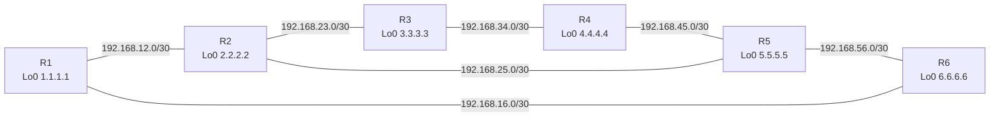

# 2026-11-19 XRd 6台のラボと、IOS XR の BGP・OSPF の広報

## 今日やったこと

- CML で **XRd を6台**使ったラボを組み、IP アドレスとループバックを設定した
- XRd で、一部のリンクに ping が通らない問題に当たった
- R2 と R3 の間で **eBGP** を張ろうとして、IOS XR の BGP の設定でつまずいた
- OSPF と BGP の「広報」の違いを整理した

## ラボの構成

XRd（IOS XRd 26.1.1、Control Plane 版）を6台。四角形（R1-R2-R3-R4-R5-R6）に、渡りのリンク（R1-R6、R2-R5）を足した。



!!! note "アドレスの決め方"
    リンクのネットワークは、**つながっているルータの番号を第3オクテットにした /30**（R1-R2 なら 192.168.12.0/30）。番号の小さい方を .1、大きい方を .2 にした。どのリンクのアドレスか、見ただけでわかる。

| リンク | ネットワーク | 番号の小さい側 | 番号の大きい側 |
| --- | --- | --- | --- |
| R1 - R2 | 192.168.12.0/30 | R1 Gi0/0/0/0 .1 | R2 Gi0/0/0/1 .2 |
| R2 - R3 | 192.168.23.0/30 | R2 Gi0/0/0/0 .1 | R3 Gi0/0/0/1 .2 |
| R3 - R4 | 192.168.34.0/30 | R3 Gi0/0/0/2 .1 | R4 Gi0/0/0/2 .2 |
| R4 - R5 | 192.168.45.0/30 | R4 Gi0/0/0/0 .1 | R5 Gi0/0/0/1 .2 |
| R5 - R6 | 192.168.56.0/30 | R5 Gi0/0/0/0 .1 | R6 Gi0/0/0/1 .2 |
| R1 - R6 | 192.168.16.0/30 | R1 Gi0/0/0/2 .1 | R6 Gi0/0/0/2 .2 |
| R2 - R5 | 192.168.25.0/30 | R2 Gi0/0/0/2 .1 | R5 Gi0/0/0/2 .2 |

- XRd は1台 **3GB**。XRv 9000（20GB）と比べて、ずっと軽い
- ログインは cisco / cisco

## XRd で、一部のリンクに ping が通らなかった

最初に組んだラボでは、**Gi0/0/0/2 を使う3本のリンク**だけ ping が通らなかった。両側とも IF は Up / Up でアドレスも合っているのに、相手からパケットが1つも届かない。

| 試したこと | 結果 |
| --- | --- |
| リンクの Stop → Start | 直らない |
| ノードの Stop → Start | 直らない |
| ラボ全体の Stop → Start | 直らない |
| **新しいラボで、リンクを張ってからノードを起動** | 7本中6本が最初から通った |
| 残り1本（R1-R6）の両端のノードを Stop → Start | 通った |

!!! tip "わかったこと"
    - XRd はコンテナで動いている。**リンクを先に張ってから、ノードを起動する**ほうが安定する
    - うまく通らないリンクがあったら、**両端のノードを再起動**すると直ることがある
    - 起動したあとにリンクを足すと、中までつながらないことがある

## IOS XR の BGP でつまずいたところ

R2（AS 65000）と R3（AS 65001）の間で eBGP を張った。

### ① `The address family has not been initialized`

```
router bgp 65001
 neighbor 192.168.23.1
  address-family ipv4 unicast
!!% 'BGP' detected the 'warning' condition 'The address family has not been initialized'
```

- 意味：「そのアドレスファミリは、まだ初期化（有効化）されていません」
- IOS XR の BGP では、アドレスファミリを **2か所** で有効にする必要がある
    1. `router bgp` の**直下**（BGP 全体で使う、という宣言）
    2. `neighbor` の下（そのネイバーと使う、という宣言）
- ②だけ入れて①がなかったので、警告が出た

### ② remote-as が相手の AS と違った

R2 で、R3 の `remote-as` を自分と同じ 65000 にしていた。R3 の本当の AS は 65001 なので、接続しにいっても合わずに切れ、`Idle` に戻っていた。`remote-as` は**相手の AS 番号**を書く。

### ③ eBGP は route-policy がないと経路をやりとりしない

`show bgp summary` に、次のメッセージと `!` 付きのネイバーが出た。

```
Some configured eBGP neighbors (under default or non-default vrfs)
do not have both inbound and outbound policies configured for IPv4 Unicast
address family. These neighbors will default to sending and/or
receiving no routes and are marked with '!' in the output below.

Neighbor        Spk    AS MsgRcvd MsgSent       TblVer  InQ OutQ  Up/Down  St/PfxRcd
192.168.23.1      0 65000      25      25            2    0    0 00:01:43          0!
```

- 意味：「inbound と outbound の両方のポリシーがない eBGP ネイバーとは、初期設定では経路を**送らない・受け取らない**」
- IOS XR では、eBGP のネイバーに `route-policy` を入れないと、**ネイバーは張れても経路が1つも交換されない**（IOS と違うところ）
- まずは全部通すポリシーを作って、`in` と `out` の両方に入れる

```
route-policy PASS
  pass
end-policy
!
router bgp 65000
 address-family ipv4 unicast
  network 2.2.2.2/32
 !
 neighbor 192.168.23.2
  remote-as 65001
  address-family ipv4 unicast
   route-policy PASS in
   route-policy PASS out
```

### `show bgp summary` の見方

| St/PfxRcd の列 | 意味 |
| --- | --- |
| `Idle`、`Active` など（文字） | ネイバーがまだ張れていない |
| 数字（`0`、`1` など） | ネイバーは張れている。数字は受け取った経路の数 |
| 数字の後ろに `!` | eBGP で route-policy が足りず、経路をやりとりしない状態 |

## OSPF と BGP の「広報」の違い

### BGP の `network`

- `network` の後ろに書いたプレフィックスが、BGP で相手に広報される経路になる
- ただし、そのプレフィックスが**ルーティングテーブルに完全に同じ形（長さも同じ）で載っている**ことが条件
- `network` は経路を新しく作るコマンドではなく、**ルーティングテーブルにある経路の中から、広報するものを選ぶ**コマンド

| network に書いたもの | ルーティングテーブル | 広報されるか |
| --- | --- | --- |
| `2.2.2.2/32` | `L 2.2.2.2/32`（ループバック） | される |
| `2.2.2.0/24` | `2.2.2.2/32` しかない | されない（長さが違う） |
| `10.0.0.0/8` | 載っていない | されない |

広報されるまでの流れ：ルーティングテーブルにある → BGP テーブルに入る（`show bgp`）→ `route-policy ... out` を通る → 相手に送られる

### OSPF の「IF のネットワークを広報する」

IF に IP アドレスを付けるときは、必ずマスクも付ける。

```
interface GigabitEthernet0/0/0/1
 ipv4 address 192.168.1.2 255.255.255.0
```

| | 値 | 意味 |
| --- | --- | --- |
| IP アドレス | 192.168.1.2 | ルータ自身の住所 |
| **ネットワーク** | **192.168.1.0/24** | この IF の先にいる、192.168.1.0〜192.168.1.255 の範囲 |

この範囲が「**IF のネットワーク**」。OSPF でこの IF を有効にすると、次の2つが起きる。

1. その IF で **Hello を送る**（つながった先にルータがいれば、ネイバーになる）
2. その IF のネットワークを、**ほかのルータに教える**（「R1 の先に 192.168.1.0/24 があるよ」）← これが「広報」

ネットワーク番号は自分で書かなくても、**IF の IP アドレスとマスクから、OSPF が自動で計算して**教えてくれる。[物理 IF だけで有効にしたときの検証](../verification/ospf/physical-if-only.md) で、Router LSA に `a Stub Network 192.168.1.0 / 255.255.255.0` が増えたのがこれ。

### まとめ

| | OSPF | BGP |
| --- | --- | --- |
| 指定するもの | **IF**（`interface Gi0/0/0/1`） | **経路**（`network 192.168.1.0/24`） |
| 広報されるもの | その IF の IP アドレスとマスクから計算したネットワーク | 書いたプレフィックス（ルーティングテーブルにあれば） |
| ネットワーク番号を自分で書くか | 書かない（自動） | 書く |

!!! abstract "一言でまとめると"
    - **OSPF**：IF を選ぶと、その IF のネットワークが自動で広報される
    - **BGP**：ルーティングテーブルにある経路の中から、広報するものを `network` で選ぶ
