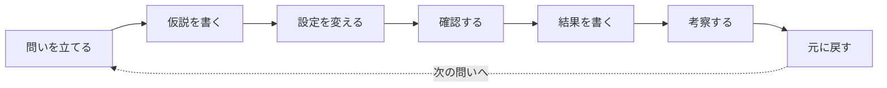

# 検証の進め方

ラボで何かを確かめるときの、自分なりの進め方。1つの問いにつき、この流れを1回まわす。

## 1. 問いを立てる

「何を確かめたいのか」を一文で書く。大きなテーマは、1回の検証で答えが出る小さな問いに分ける。

- 例：テーマ「OSPF で何が広報されるのか」→ 問い「ループバックはどんな形で広報されるか」

## 2. 仮説を書く

試す前に「自分はこうなると思う」を書いておく。うまく書こうとせず、思ったことをそのまま書く。外れた仮説ほど、考察で学べることが多い。

## 3. 設定を変える

- **変更前の状態を記録しておく**（設定と確認コマンドの出力をスクリーンショット）
- 一度に変えるのは1か所だけにする。複数を同時に変えると、どの変更が結果に効いたのかわからなくなる

## 4. 確認する

結果を見るコマンドと、理由を見るコマンドを分けて考える。

| 何を見るか | 例 |
| --- | --- |
| 動いているか（設定が効いているか） | `show ip ospf interface brief`、`show ip interface brief` |
| 結果（どうなったか） | `show ip route`、`ping`、`traceroute` |
| 理由（なぜそうなったか） | `show ip ospf database`、`debug` 系 |

変更後の出力もスクリーンショットしておく。変更前と並べると違いがわかりやすい。

## 5. 結果を書く

- 何が起きたかを事実として書く
- 仮説どおりだったか、違ったかを書く

## 6. 考察する

なぜその結果になったのかを、理由を見るコマンドの出力やドキュメントを根拠に説明する。わからなかったことは「次の問い」として残しておく。

## 7. 元に戻してから次へ

設定を元に戻し、変更前と同じ状態になったことを確認してから次の問いに進む。前の変更が残っていると、次の検証結果がずれる。

!!! tip "便利な小技"
    - CML なら、検証前に LAB →「Extract Configs」で設定を保存しておくと、すぐ元に戻せる
    - 確認コマンドは毎回同じものを同じ順番で打つと、結果を比べやすい
    - スクリーンショットには、どのルータの出力か（ホスト名）が写るようにする
