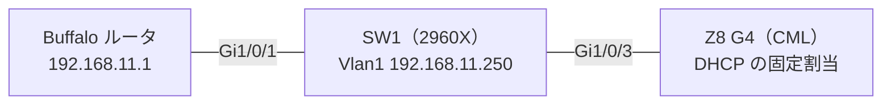

# リンクは上がっているのに通信できないとき（LAN ポートの挿し間違い）

- 起きた日：[2026-11-22](../study-log/2026-11-22.md)（自宅ラボに SW1 を入れて、Z8 G4 をつなぎ直したとき）

## 何が起きたか

Z8 G4（CML 専用機）のケーブルを SW1 の Gi1/0/3 につなぎ直したあと、**ポートは `connected` なのに、CML の管理画面に届かなくなった**。SW1 から CML の IP に ping しても通らない。



CML の IP アドレスは、Buffalo の DHCP で **MAC アドレスごとの固定割当**にしていた。

## 切り分け

下の層から順に、どこまで届いているかを確かめた。

**1. SW1 の IP の設定**

```text
SW1#show ip interface brief | include Vlan1
Vlan1                  192.168.11.250  YES manual up                    up
```

`up / up` なので、SW1 の IP の設定は問題ない。

**2. SW1 からルータへ**

```text
SW1#ping 192.168.11.1
!!!!!
Success rate is 100 percent (5/5)
```

ルータまでは届く。SW1 と Buffalo の間は問題ない。原因は Z8 の側にしぼれた。

**3. Z8 からフレームが届いているか**

```text
SW1#show mac address-table interface Gi1/0/3
Vlan    Mac Address       Type        Ports
----    -----------       --------    -----
   1    xxxx.xxxx.33d5    DYNAMIC     Gi1/0/3
```

MAC アドレスが見えるので、Z8 は通信している。

**4. DHCP の固定割当と見比べる**

Buffalo の固定割当に登録していた MAC アドレスと、3 で見えた MAC アドレスが**違っていた**。

## 原因

**Z8 G4 には LAN ポートが2つあり、CML が使っていないほうのポートに挿していた。**

- ポートごとに MAC アドレスが違う
- 固定割当に登録していないほうの MAC なので、いつもの IP がもらえていなかった
- リンクは上がるので、`show interfaces status` では `connected` に見えてしまう

## 直し方

もう片方のポートに挿し直したら、いつもの IP がもらえて CML の管理画面に入れた。使っているポートには印を付けた。

## 確認に使えるコマンド

| どこで | コマンド | 何を見るか |
| --- | --- | --- |
| スイッチ | `show ip interface brief` | 自分の IP と Vlan インタフェースの状態 |
| スイッチ | `ping <ゲートウェイ>` | スイッチから上流までは届くか |
| スイッチ | `show mac address-table interface <IF>` | そのポートの先から、どの MAC が届いているか |
| スイッチ | `show ip arp` | MAC と IP の対応 |
| ルータの管理画面 | DHCP のリース一覧・固定割当 | どの MAC にどの IP を配っているか |

## わかったこと

- **`connected` はケーブルがつながっているだけ**。正しい相手が、正しい設定でつながっているかは別に確かめる
- 下の層から順に（自分の IP → 上流への ping → MAC アドレス → IP の割り当て）確かめると、場所をしぼりこめる
- [Desktop を Wipe したあと、ping が通らなくなったとき](stale-arp-after-wipe.md) と同じく、IP が合っていそうでも **MAC アドレス（L2）を見る**のが近道だった
