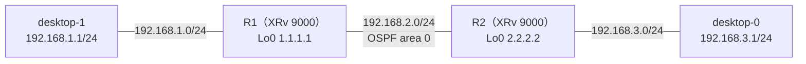

# エリアの不一致と、ICMP を落とす ACL（壊れている場所が2つ）

- 起きた日：2026-10-29（トラブルシューティング演習 第6問）
- 出題のしかた：Claude にラボの設定を変えてもらい、何か所変えたかも聞かずに自分で原因を特定した
- 初期状態：R1・R2 とも、OSPF にループバック・ルータ間の IF（P2P）・PC 側の IF（passive）が入っている状態
- 前の問題：[第1問](ospf-hello-interval.md)〜[第5問](ospf-network-type-mismatch.md)、[OSPF の切り分けの手順](ospf-troubleshooting-flow.md)

## 何が起きたか

**desktop-0 から desktop-1（192.168.1.1）に ping が通らなくなった。** それまでは通っていた。



## 原因

壊れている場所は **2つ** あった。

| | どこ | 何が起きていたか | 影響 |
| --- | --- | --- | --- |
| ① | **R2** の OSPF | ルータ間の G0/0/0/0 が **area 0 から area 1 に移されていた**。R1 側は area 0 のまま | Hello に書かれたエリア番号が合わず、**ネイバーが張れない**。経路が交換されない |
| ② | **R1** の G0/0/0/1（desktop-1 側） | **ICMP を落とす ACL** が、出ていく方向（egress）にかけられていた | 経路が戻っても、**desktop-1 宛ての ping（ICMP）だけ**が R1 で捨てられる |

R2 に入っていた設定（①）：

```
router ospf 1
 area 0
  interface Loopback0
  !
  interface GigabitEthernet0/0/0/1
   passive enable
  !
 !
 area 1
  interface GigabitEthernet0/0/0/0     ← area 0 から移されていた
   network point-to-point
  !
 !
!
```

R1 に入っていた設定（②）：

```
ipv4 access-list FILTER-LAN
 10 deny icmp any any
 20 permit ipv4 any any
!
interface GigabitEthernet0/0/0/1
 ipv4 access-group FILTER-LAN egress   ← desktop-1 へ出ていく ICMP を落とす
!
```

### それぞれの見つけ方（切り分けの手順のどこで見つかるか）

| | 切り分けの手順 | 手がかり |
| --- | --- | --- |
| ① エリアの不一致 | ③ ネイバーが**出てこない** → ④ Hello が合わない | `show ospf interface brief` の Area の列が、R1 と R2 で違う |
| ② ACL | ② 経路は**ある** → ⑦ 経路はあるのに通らない | `show run interface GigabitEthernet0/0/0/1` に `ipv4 access-group` がある。ICMP 以外（たとえば TCP）は通る |

!!! note "①を直しても、まだ ping は通らない"
    ①を直すとネイバーが張れて、経路も戻る。それでも ping は通らない。**経路があるのに通らない**ときは、L2（ARP）や ACL など、ルーティング以外を疑う。

## 自分がやった切り分け

（どの順番で、何を見て、2つに気づいたかを書く）

## 直し方

① R2 の G0/0/0/0 を area 0 に戻す。

```
configure
 router ospf 1
  area 1
   no interface GigabitEthernet0/0/0/0
  !
  no area 1
  area 0
   interface GigabitEthernet0/0/0/0
    network point-to-point
   !
  !
 !
commit
end
```

② R1 の G0/0/0/1 から ACL を外し、ACL を消す。

```
configure
 interface GigabitEthernet0/0/0/1
  no ipv4 access-group FILTER-LAN egress
 !
 no ipv4 access-list FILTER-LAN
commit
end
```

## 確認に使えるコマンド

| コマンド | 何を見るか |
| --- | --- |
| `show ospf interface brief` | **Area の列**。ルータ間の IF のエリアが、両側で同じか |
| `show ospf neighbor` | ネイバーが出てくるか |
| `show logging \| include OSPF` | ネイバーが落ちた時刻やメッセージ |
| `show run interface <IF>` | `ipv4 access-group` が入っていないか |
| `show access-lists ipv4 <名前>` | ACL の中身と、何回当たったか（`matches`）。**数が増えていれば、その行で落ちている** |

## わかったこと

- OSPF のネイバーは、**エリア番号が相手と同じ**でないと張れない（Hello にエリア番号が入っている）
- 経路があるのに ping が通らないときは、**ACL** も疑う。ACL は、特定のプロトコル（今回は ICMP）だけを落とすことがある
- 壊れている場所が複数あると、1つ直しても症状が変わらない。**1つ直すたびに、どこまで直ったか**（ネイバー、経路、ping）を確かめる
