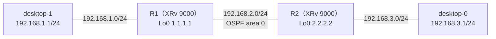

# OSPF の認証の不一致と、PC の IF の down（壊れている場所が2つ）

- 起きた日：2026-10-29（トラブルシューティング演習 第7問）
- 出題のしかた：Claude にラボの設定を変えてもらい、何か所変えたかも聞かずに自分で原因を特定した
- 初期状態：R1・R2 とも、OSPF にループバック・ルータ間の IF（P2P）・PC 側の IF（passive）が入っている状態
- 前の問題：[第6問](ospf-area-and-acl.md)、[OSPF の切り分けの手順](ospf-troubleshooting-flow.md)

## 何が起きたか

**desktop-1 から desktop-0（192.168.3.1）に ping が通らなくなった。** 今回は、これまでと逆向きに ping を打った。



## 原因

壊れている場所は **2つ** あった。

| | どこ | 何が起きていたか | 影響 |
| --- | --- | --- | --- |
| ① | **R2** の OSPF | ルータ間の G0/0/0/0 だけに **OSPF の認証（MD5）** が入っていた。R1 は認証なし | 認証が合わないので Hello を受け取らず、**ネイバーが張れない** |
| ② | **desktop-0** | PC の **eth1 が down** にされていた | desktop-0 に届かない。IF を down にすると、**デフォルトルートも消える** |

R2 に入っていた設定（①）：

```
router ospf 1
 area 0
  interface GigabitEthernet0/0/0/0
   network point-to-point
   authentication message-digest           ← 入れられていた
   message-digest-key 1 md5 encrypted ...  ← 入れられていた
  !
```

desktop-0（②）：

```
desktop-0:~$ ip link show eth1
3: eth1: <BROADCAST,MULTICAST> mtu 1500 qdisc pfifo_fast state DOWN qlen 1000
```

`UP` と `LOWER_UP` がなく、`state DOWN` になっている。

!!! warning "CML では、PC の IF を down にしても、ルータ側は Up のまま"
    desktop-0 の eth1 を down にしても、R2 の G0/0/0/1 は `Up / Up` のまま表示される。実機なら相手の IF が down すれば自分もリンクダウンするが、CML ではそうならない（[ping が届かないとき](ping-unreachable.md) で見た、CML のリンクの見え方と同じ）。**ルータ側の IF が Up でも、相手の PC を直接確かめる**必要がある。

### それぞれの見つけ方（切り分けの手順のどこで見つかるか）

| | 切り分けの手順 | 手がかり |
| --- | --- | --- |
| ① 認証の不一致 | ③ ネイバーが**出てこない** → ④ Hello が合わない | `show ospf interface <IF>` で認証の有無が R1 と R2 で違う。`show run router ospf` に `authentication` がある |
| ② PC の IF の down | ① PC：IP とゲートウェイ | `ip link show eth1` が `state DOWN`。`ip route` にデフォルトルートがない |

## 自分がやった切り分け

（どの順番で、何を見て、2つに気づいたかを書く）

## 直し方

① R2 の G0/0/0/0 から認証の設定を消した。

```
configure
 router ospf 1
  area 0
   interface GigabitEthernet0/0/0/0
    no authentication message-digest
    no message-digest-key 1
   !
  !
 !
commit
end
```

!!! note "実務では「両方に入れる」こともある"
    今回は初期状態に認証がなかったので、変えられた R2 から消して戻した。実務で OSPF の認証を使う網なら、逆に「入っていない方に、同じ方式・同じキーを入れる」のが正しい直し方になる。**どちらが正しい状態か**（設計）を確かめてから直す。

② desktop-0 の eth1 を上げて、デフォルトルートを入れ直した。

```
sudo ip link set eth1 up
sudo ip route add default via 192.168.3.2 dev eth1
```

直したあと、OSPF の設定は初期状態と同じに戻り、desktop-1 から desktop-0 への ping も通った。

## 確認に使えるコマンド

| どこで | コマンド | 何を見るか |
| --- | --- | --- |
| R1・R2 | `show ospf neighbor` | ネイバーが出てくるか |
| R1・R2 | `show ospf interface <IF>` | 認証の設定（Message digest authentication など）が両側で同じか |
| R1・R2 | `show logging \| include OSPF` | 認証が合わないときのメッセージ |
| PC | `ip link show eth1` | `UP`・`LOWER_UP`・`state UP` か |
| PC | `ip route` | IF を上げたあと、デフォルトルートが残っているか |

## わかったこと

- OSPF の認証は、**両側で方式とキーがそろっていないとネイバーが張れない**（Hello に認証の情報が入っている）
- 直すときは、**どちらが正しい状態か**（認証を使う設計かどうか）を確かめる
- CML では、PC の IF を down にしても、**ルータ側の IF は Up のまま**に見える。ルータだけ見て安心しない
- PC の IF を down にすると、**デフォルトルートも消える**。上げたら入れ直す
