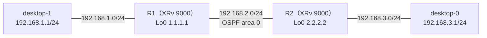

# OSPF の Hello の間隔が合わないとき

- 起きた日：2026-10-28（トラブルシューティング演習 第1問）
- 出題のしかた：Claude にラボの設定を1か所だけ変えてもらい、どこを変えたかは聞かずに自分で原因を特定した

## 何が起きたか

**desktop-0 から desktop-1（192.168.1.1）に ping が通らなくなった。** それまでは通っていた。



| 機器 | 正常なときの設定 |
| --- | --- |
| R1・R2 | OSPF area 0 に G0/0/0/0（ルータ間、point-to-point）と G0/0/0/1（PC 向け） |
| desktop-0 | 192.168.3.1/24、ゲートウェイ 192.168.3.2（R2） |
| desktop-1 | 192.168.1.1/24、ゲートウェイ 192.168.1.2（R1） |

## 原因

**R2 の G0/0/0/0 の OSPF の Hello の間隔（hello-interval）が 5秒に変えられていた。** R1 は初期値の 10秒のまま。

```
RP/0/RP0/CPU0:iOS-XR-R2#show run router ospf
router ospf 1
 router-id 2.2.2.2
 area 0
  interface GigabitEthernet0/0/0/0
   network point-to-point
   hello-interval 5          ← 変えられていた
  !
  interface GigabitEthernet0/0/0/1
  !
 !
!
```

- OSPF は、**Hello の間隔と Dead の間隔が相手と同じでないと、ネイバーにならない**
- ネイバーが落ちると、相手から PC 側のネットワーク（192.168.1.0/24、192.168.3.0/24）の経路が届かなくなり、ルーティングテーブルから消える
- 経路がないので、PC 同士の ping が通らなくなった

## 自分がやった切り分け

（どのコマンドで、何を見て、Hello の間隔に気づいたかを書く）

## 直し方

Hello の間隔を R1 と R2 でそろえれば、ネイバーが張れて ping も通る。そろえ方は2つある。

| 直し方 | 設定 | 考え方 |
| --- | --- | --- |
| ① 変えられた方を元に戻す | R2 で `no hello-interval 5` | **実務ではこちらが基本**。勝手に変わった方を戻す。ほかのルータとの整合も崩れない |
| ② 相手に合わせる | R1 でも `hello-interval 5` | 今回はこちらで直した。ネイバーは張れるが、R1 のほかの隣接ルータとまた合わなくなるおそれがある |

??? note "R2 を元に戻す設定（①）"
    ```
    configure
     router ospf 1
      area 0
       interface GigabitEthernet0/0/0/0
        no hello-interval 5
       !
      !
     !
    commit
    end
    ```

### 設定を入れる場所で、効く範囲が変わる

今回、R1 では `area 0` の直下に `hello-interval 5` を入れた。

```
router ospf 1
 area 0
  hello-interval 5           ← area の直下：area 0 の全インターフェースに効く
  interface GigabitEthernet0/0/0/0
   network point-to-point
  !
  interface GigabitEthernet0/0/0/1
  !
```

| 入れた場所 | 効く範囲 |
| --- | --- |
| `router ospf` の直下 | その OSPF プロセスの全インターフェース |
| `area` の直下 | そのエリアの全インターフェース（今回は G0/0/0/1 の PC 側にも効いている） |
| `interface` の下 | そのインターフェースだけ |

IOS XR の OSPF の設定は、上で入れた値が下に引き継がれ、下で入れた値が優先される。

## 確認に使えるコマンド

| コマンド | 何を見るか |
| --- | --- |
| `show ospf neighbor` | 相手とネイバーになっているか（FULL か、そもそも表示されないか） |
| `show ospf interface GigabitEthernet0/0/0/0` | `Timer intervals configured, Hello 10, Dead 40` のように、Hello と Dead の間隔が出る。**相手と見比べる** |
| `show route ospf` | 相手の PC 側のネットワークが `O` で載っているか |
| `debug ospf adj`（XR） | Hello を受け取ったときに、何が合わないかが出る。使い終わったら `undebug all` |

## わかったこと

- OSPF のネイバーは、**Hello の間隔と Dead の間隔が相手と同じ**でないと張れない
- Hello の間隔を変えると、Dead の間隔は自動で**4倍**になる（Hello 5秒なら Dead 20秒）
- 直すときは、**変わってしまった方を元に戻す**のが基本
- `area` の直下に入れた設定は、そのエリアの全インターフェースに効く
