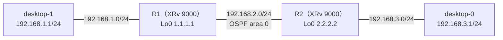

# OSPF のネイバーが EXSTART / EXCHANGE で止まるとき（MTU の不一致）

- 起きた日：2026-10-28（トラブルシューティング演習 第3問）
- 出題のしかた：Claude にラボの設定を1か所だけ変えてもらい、どこを変えたかは聞かずに自分で原因を特定した
- 出題時のヒント：「第1問・第2問とは別の原因で、OSPF の設定ではない」
- 前の問題：[OSPF の Hello の間隔が合わないとき](ospf-hello-interval.md)（第1問）、[ルータ間の IF が OSPF の passive になっていたとき](ospf-passive.md)（第2問）

## 何が起きたか

**desktop-0 から desktop-1（192.168.1.1）に ping が通らなくなった。** それまでは通っていた。



正常なときの設定は、ルータ間（G0/0/0/0）は OSPF の通常の IF、PC 側（G0/0/0/1）は passive。

## 原因

**R2 の G0/0/0/0 に `mtu 1400` が入っていて、R1 と MTU が合っていなかった。** OSPF の設定ではなく、インターフェースの設定。

```
RP/0/RP0/CPU0:iOS-XR-R2#show running-config interface GigabitEthernet0/0/0/0
interface GigabitEthernet0/0/0/0
 description iOS-XR-R1
 mtu 1400                    ← 入れられていた
 ipv4 address 192.168.2.2 255.255.255.0
!
```

このときのネイバーは、**FULL にならず、途中の状態で止まっていた**。

```
RP/0/RP0/CPU0:iOS-XR-R1#show ospf neighbor

Neighbor ID     Pri   State           Dead Time   Address         Interface
2.2.2.2         1     EXCHANGE/  -    00:00:38    192.168.2.2     GigabitEthernet0/0/0/0
```

### なぜ MTU が合わないと止まるのか

OSPF のネイバーは、次の順番で FULL になる。


- **Hello（Init・2-Way まで）**：Hello には MTU は入っていない。なので、MTU が違ってもここまでは進む
- **DBD（ExStart・Exchange）**：お互いの LSDB の目次（DBD）を交換する段階。**DBD には、送ったルータの IF の MTU が書かれている**。受け取った側は、自分の MTU より大きい値が書かれた DBD を受け取らない
- そのため、DBD の交換が終わらず、**ExStart / Exchange で止まる**。FULL にならないので経路も交換されず、PC 同士の ping が通らない

!!! note "第1問・第2問との違い"
    | | ネイバーの状態 | 原因 |
    | --- | --- | --- |
    | 第1問（Hello の間隔） | 出てこない | Hello の中身が合わない |
    | 第2問（passive） | 出てこない | Hello を送らない |
    | **第3問（MTU）** | **出てくるが、EXSTART / EXCHANGE で止まる** | Hello は通るが、DBD の交換で止まる |

    **ネイバーがどの状態で止まっているか**で、原因の見当がつく。

!!! note "ルータ同士の小さい ping は通る"
    MTU が違っても、R1 と R2 の間で小さいパケットの ping は通る。「ping が通るのにネイバーが張れない」ときは、MTU を疑う。

## 自分がやった切り分け

（どのコマンドで、何を見て、MTU に気づいたかを書く）

## 直し方

MTU を R1 と R2 でそろえれば、DBD の交換が終わって FULL になる。そろえ方は2つある。

| 直し方 | 設定 | 考え方 |
| --- | --- | --- |
| ① 変えられた方を元に戻す | R2 で `no mtu` | **実務ではこちらが基本**。勝手に変わった方を戻す |
| ② 相手に合わせる | R1 でも `mtu 1400` | 今回はこちらで直した。FULL になり ping も通る。ただし、このリンクで送れるパケットの大きさが小さくなる |

??? note "R2 を元に戻す設定（①）"
    ```
    configure
     interface GigabitEthernet0/0/0/0
      no mtu
     !
    commit
    end
    ```

!!! warning "`mtu-ignore` はなるべく使わない"
    OSPF には、DBD の MTU の確認を飛ばす `mtu-ignore` という設定もある。ネイバーは FULL になるが、MTU が違うこと自体は直っていないので、大きいパケット（大きな LSA の更新など）が落ちる原因が残る。**MTU そのものをそろえる**のが基本。

## 確認に使えるコマンド

| コマンド | 何を見るか |
| --- | --- |
| `show ospf neighbor` | ネイバーの状態。**EXSTART / EXCHANGE で止まっていないか** |
| `show interfaces GigabitEthernet0/0/0/0` | IF の MTU（`MTU 1514 bytes` など）。相手と見比べる |
| `show ospf interface GigabitEthernet0/0/0/0` | OSPF が使っている MTU（`MTU 1500` など） |
| `show running-config interface <IF>` | `mtu` の設定が入っていないか |
| `debug ospf adj`（XR） | DBD を受け取ったときに、MTU が合わないと出る。使い終わったら `undebug all` |

!!! note "IOS XR の mtu の値"
    IOS XR の IF の `mtu` は、L2 のヘッダ（イーサネットの 14 バイト）を含んだ値。GigabitEthernet の初期値は 1514 で、IP の MTU は 1500 になる。`mtu 1400` にすると、IP の MTU は 1386 になる。

## わかったこと

- OSPF のネイバーは、**DBD の交換のときに MTU を確認する**。MTU が違うと EXSTART / EXCHANGE で止まる
- Hello には MTU が入っていないので、ネイバーとしては見える（ここが第1問・第2問との違い）
- **ネイバーがどの状態で止まっているか**を見ると、原因の見当がつく
- 原因は OSPF の設定ではなく、**インターフェースの設定**にあることもある
