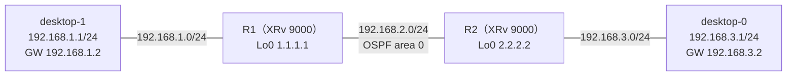

# 壊れている場所が2つあったとき（OSPF の対象外の IF と、PC のゲートウェイ）

- 起きた日：2026-10-28（トラブルシューティング演習 第4問）
- 出題のしかた：Claude にラボの設定を変えてもらい、**何か所変えたかも聞かずに**自分で原因を特定した
- 前の問題：[第1問](ospf-hello-interval.md)、[第2問](ospf-passive.md)、[第3問](ospf-mtu-mismatch.md)

## 何が起きたか

**desktop-0 から desktop-1（192.168.1.1）に ping が通らなくなった。** それまでは通っていた。



正常なときの設定は、ルータ間（G0/0/0/0）は OSPF の通常の IF、PC 側（G0/0/0/1）は passive。

## 原因

壊れている場所は **2つ** あった。1つ直しても、まだ ping は通らない。

| | どこ | 何が起きていたか | 影響 |
| --- | --- | --- | --- |
| ① | **R2** の OSPF | PC 側の G0/0/0/1 が、OSPF の対象から外されていた（`router ospf 1` の `area 0` から `interface GigabitEthernet0/0/0/1` が消えていた） | R2 が 192.168.3.0/24 を広報しない。**R1 は desktop-0 側への経路を持たない**（帰り道がない） |
| ② | **desktop-1** | デフォルトゲートウェイが **192.168.1.3**（存在しないアドレス）に変えられていた。正しくは R1 の 192.168.1.2 | desktop-1 から外のネットワークへ出られない |

### パケットで考えると

desktop-0 → desktop-1 の ping（Echo Request）と、desktop-1 → desktop-0 の返事（Echo Reply）に分けて考える。

| 向き | 通る順番 | ①の影響 | ②の影響 |
| --- | --- | --- | --- |
| 行き（Request） | desktop-0 → R2 → R1 → desktop-1 | なし（R2 は R1 から 192.168.1.0/24 を学んでいる） | なし |
| 帰り（Reply） | desktop-1 → **ゲートウェイ** → R1 → R2 → desktop-0 | **R1 が 192.168.3.0/24 を知らないので捨てる** | **desktop-1 がゲートウェイ（192.168.1.3）に送れない** |

**どちらも帰り道を壊している**ので、どちらか片方を直しても、もう片方で止まる。

## 自分がやった切り分け

（どの順番で、どのコマンドで、何を見て2つに気づいたかを書く）

## 直し方

① R2 の OSPF に、PC 側の G0/0/0/1 を戻した。

```
configure
 router ospf 1
  area 0
   interface GigabitEthernet0/0/0/1
    passive enable
   !
  !
 !
commit
end
```

!!! note "passive も戻す"
    正常な状態（ベースライン）では、PC 側の G0/0/0/1 は passive だった。`interface GigabitEthernet0/0/0/1` を戻すだけでも ping は通るが、元の状態に戻すなら `passive enable` も入れる。

② desktop-1 のデフォルトゲートウェイを、R1 の 192.168.1.2 に戻した。

```
sudo ip route del default
sudo ip route add default via 192.168.1.2 dev eth1
```

## 確認に使えるコマンド

| どこで | コマンド | 何を見るか |
| --- | --- | --- |
| R1 / R2 | `show route ospf` | 相手の PC 側のネットワークが `O` で載っているか。**両方のルータで**見る |
| R1 / R2 | `show run router ospf` | PC 側の IF が OSPF の対象に入っているか |
| R1 / R2 | `show ospf interface brief` | OSPF が有効な IF の一覧。PC 側の IF が出てくるか |
| PC | `ip route` | `default via` のゲートウェイが正しいか |
| PC | `ping <ゲートウェイ>` | 自分のゲートウェイに届くか（②はここで気づける） |

## わかったこと

- 壊れている場所は1つとは限らない。**1つ直したら、もう一度確かめる**
- ping は**行きと帰りの両方**がそろわないと通らない。帰り道も1台ずつ確かめる
- ルータだけでなく、**PC の設定（IP アドレス、ゲートウェイ）**も疑う
- 片方のルータで経路が見えていても、もう片方では見えていないことがある。**両方のルータ**で確かめる
