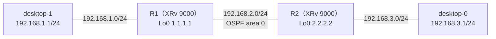

# ネイバーは FULL なのに経路が載らないとき（ネットワークタイプの不一致）

- 起きた日：2026-10-28（トラブルシューティング演習 第5問）
- 出題のしかた：Claude にラボの設定を変えてもらい、何か所変えたかも聞かずに自分で原因を特定した
- 前の問題：[第1問](ospf-hello-interval.md)、[第2問](ospf-passive.md)、[第3問](ospf-mtu-mismatch.md)、[第4問](ospf-multiple-faults-1.md)

## 何が起きたか

**desktop-0 から desktop-1（192.168.1.1）に ping が通らなくなった。** それまでは通っていた。



正常なときの設定は、ルータ間（G0/0/0/0）は両方とも `network point-to-point`、PC 側（G0/0/0/1）は passive。

## 原因

**R1 の G0/0/0/0 から `network point-to-point` が消されていた。** R1 は初期値の BROADCAST、R2 は POINT_TO_POINT になり、**ネットワークタイプが合っていなかった**。

```
RP/0/RP0/CPU0:iOS-XR-R1#show run router ospf
router ospf 1
 router-id 1.1.1.1
 area 0
  interface GigabitEthernet0/0/0/0
                             ← network point-to-point が消えていた
  !
  interface GigabitEthernet0/0/0/1
   passive enable
  !
 !
!
```

このときの特徴は、**ネイバーは FULL なのに、経路が1つも載っていない**こと。

```
RP/0/RP0/CPU0:iOS-XR-R1#show ospf neighbor

Neighbor ID     Pri   State           Dead Time   Address         Interface
2.2.2.2         1     FULL/DR         00:00:37    192.168.2.2     GigabitEthernet0/0/0/0

RP/0/RP0/CPU0:iOS-XR-R1#show route ospf

% No matching routes found
```

- `FULL/DR` の `DR` は、R1（BROADCAST 側）が R2 を DR だと思っている、という意味。正常なとき（P2P 同士）は `FULL/  -` と表示される
- R2 の `show route ospf` も空だった

### なぜネイバーは FULL なのに経路が載らないのか

- **Hello にはネットワークタイプが入っていない**ので、Hello の間隔などが合っていればネイバーになり、LSA の交換まで進む（FULL になる）
- ところが、2台が作る **Router LSA の書き方が食い違う**
    - R2（P2P）：「1.1.1.1 と point-to-point でつながっている」と書く
    - R1（BROADCAST）：「DR がいるネットワーク（transit network）につながっている」と書く
- 経路を計算（SPF）するとき、OSPF は「**お互いが、お互いにつながっていると書いているか**」（双方向の確認）を見る。書き方が食い違っているので確認が取れず、そのリンクを経路の計算に使えない
- その結果、相手の PC 側のネットワークが経路にならない

!!! note "第1〜3問との違い"
    | | ネイバーの状態 | 原因 |
    | --- | --- | --- |
    | 第1問（Hello の間隔） | 出てこない | Hello の中身が合わない |
    | 第2問（passive） | 出てこない | Hello を送らない |
    | 第3問（MTU） | EXSTART / EXCHANGE で止まる | DBD の交換で止まる |
    | **第5問（ネットワークタイプ）** | **FULL**（なのに経路がない） | LSA の書き方が食い違い、SPF で使えない |

    **ネイバーが FULL でも安心できない。** 経路が載っているかまで確かめる。

## 自分がやった切り分け

（どのコマンドで、何を見て、ネットワークタイプに気づいたかを書く）

## 直し方

R1 の G0/0/0/0 に `network point-to-point` を戻した（変えられた方を元に戻した）。

```
configure
 router ospf 1
  area 0
   interface GigabitEthernet0/0/0/0
    network point-to-point
   !
  !
 !
commit
end
```

直したあとは、ネイバーが `FULL/  -` に戻り、ping も通った。

## 確認に使えるコマンド

| コマンド | 何を見るか |
| --- | --- |
| `show ospf neighbor` | FULL の後ろが `DR` / `BDR` / `-` のどれか。P2P なら `-` |
| `show ospf interface brief` | State の列が `P2P` か `DR` / `BDR` / `DROTHER` か。**両方のルータで見比べる** |
| `show ospf interface <IF>` | `Network Type POINT_TO_POINT` / `BROADCAST` |
| `show route ospf` | ネイバーが FULL でも、経路が載っているか |
| `show ospf database router` | Router LSA のリンクが `another Router (point-to-point)` か `a Transit Network` か（[物理 IF の検証](../verification/ospf/physical-if-only.md) で見た出力） |

## わかったこと

- ネットワークタイプは、**両側でそろえる**
- ネットワークタイプが合わなくても、ネイバーは FULL になることがある。**FULL なのに経路がない**ときは、ネットワークタイプを疑う
- `show ospf neighbor` の `FULL/DR` と `FULL/  -` の違いが手がかりになる
