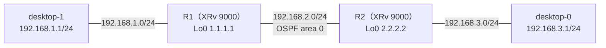

# ルータ間の IF が OSPF の passive になっていたとき

- 起きた日：2026-10-28（トラブルシューティング演習 第2問）
- 出題のしかた：Claude にラボの設定を1か所だけ変えてもらい、どこを変えたかは聞かずに自分で原因を特定した
- 前の問題：[OSPF の Hello の間隔が合わないとき](ospf-hello-interval.md)（第1問）

## 何が起きたか

**desktop-0 から desktop-1（192.168.1.1）に ping が通らなくなった。** それまでは通っていた。



## 原因

**R2 の G0/0/0/0（R1 とつながっている IF）の OSPF に `passive enable` が入っていた。**

```
RP/0/RP0/CPU0:iOS-XR-R2#show run router ospf
router ospf 1
 router-id 2.2.2.2
 area 0
  interface GigabitEthernet0/0/0/0
   network point-to-point
   passive enable            ← 入れられていた
  !
  interface GigabitEthernet0/0/0/1
  !
 !
!
```

1. R2 が G0/0/0/0 で Hello を送らなくなった
2. R1 と R2 のネイバーが落ちた
3. 相手の PC 側のネットワーク（192.168.1.0/24、192.168.3.0/24）の経路が届かなくなった
4. PC 同士の ping が通らなくなった

ネイバーが落ちて経路が消える流れは第1問と同じ。原因が「Hello の**中身が合わない**」（第1問）か、「Hello を**そもそも送らない**」（第2問）かの違い。

## 自分がやった切り分け

（どのコマンドで、何を見て、passive に気づいたかを書く）

## passive とは

**「この IF のネットワークは OSPF で広報するが、この IF では Hello を送らない（ネイバーを作らない）」**という設定。

| | 通常の IF | passive の IF |
| --- | --- | --- |
| その IF のネットワークを広報するか | する | **する**（Router LSA にスタブネットワークとして入る） |
| Hello を送るか | 送る | **送らない** |
| ネイバーを作るか | 作る | **作らない** |

### 本来はどこに使うか

**PC やお客さま側など、相手が OSPF をしゃべらない IF** に使う。

- OSPF を有効にした IF は、PC しかいなくても Hello を送り続ける。passive にすると、PC 側のネットワークは広報したまま、無駄な Hello を止められる
- PC 側から悪意のあるルータがつながっても、ネイバーにならないので、勝手な経路を入れられない（セキュリティ上の意味）
- **ルータ同士をつなぐ IF に入れると、ネイバーが張れなくなる**（今回の原因）

## 直し方

R2 の G0/0/0/0 から `passive enable` を消した。

```
configure
 router ospf 1
  area 0
   interface GigabitEthernet0/0/0/0
    no passive enable
   !
  !
 !
commit
end
```

### 本来の使い方も試した

あわせて、R1・R2 の **PC 側の IF（G0/0/0/1）を passive** にした。

```
router ospf 1
 area 0
  interface GigabitEthernet0/0/0/0
   network point-to-point          ← ルータ間：通常（Hello を送る）
  !
  interface GigabitEthernet0/0/0/1
   passive enable                  ← PC 側：passive
  !
```

- R1 と R2 のネイバーは FULL のまま
- R2 は 192.168.1.0/24 を OSPF で学んでいる（**passive にしても、PC 側のネットワークは広報されたまま**）
- desktop-0 から desktop-1 への ping も通る

`show ospf interface` で見ると、passive の IF には `No Hellos (Passive interface)` と出る。

```
RP/0/RP0/CPU0:iOS-XR-R1#show ospf interface GigabitEthernet0/0/0/1

GigabitEthernet0/0/0/1 is up, line protocol is up
  Internet Address 192.168.1.2/24, Area 0
  Process ID 1, Router ID 1.1.1.1, Network Type BROADCAST, Cost: 1
  Transmit Delay is 1 sec, State DR, Priority 1, MTU 1500, MaxPktSz 1500
  Timer intervals configured, Hello 10, Dead 40, Wait 40, Retransmit 5
    No Hellos (Passive interface)
  Neighbor Count is 0, Adjacent neighbor count is 0
（一部省略）
```

この状態を、演習の新しい「正常な状態（ベースライン）」にした。

## 確認に使えるコマンド

| コマンド | 何を見るか |
| --- | --- |
| `show ospf neighbor` | 相手とネイバーになっているか |
| `show ospf interface <IF>` | `No Hellos (Passive interface)` が出ていないか |
| `show run router ospf` | `passive enable` がどの IF に入っているか |
| `show route ospf` | 相手の PC 側のネットワークが `O` で載っているか |

## わかったこと

- passive の IF は、**ネットワークは広報するが、Hello は送らない**
- ルータ間の IF を passive にすると、ネイバーが張れなくなる
- PC やお客さま側の IF を passive にするのが本来の使い方
