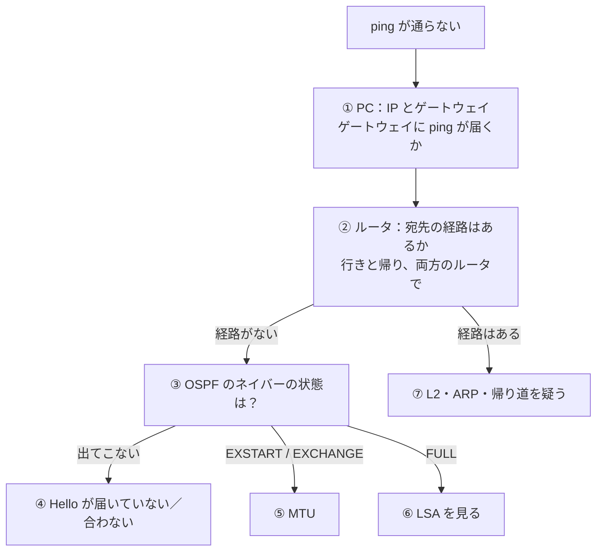

# OSPF の切り分けの手順（演習のまとめ）

演習（第1〜5問）で出てきた原因を、「どの順番で、何を見れば見つかるか」に並べ直した。**ping が通らない**ところから、**下から順に、両方向で**確かめていく。

## 全体の流れ



## ⓪ 最初に：何が変わったか

演習でも実務でも、「さっきまで通っていた」なら、**変更の履歴**を見るのが一番早い。

| コマンド（IOS XR） | 何を見るか |
| --- | --- |
| `show configuration commit list` | いつ、誰が設定を変えたか |
| `show configuration commit changes <番号>` | その変更で何が変わったか |

!!! note "演習では"
    答えを見ることになってしまうので、演習ではこれを使わずに①から順に切り分ける。実務では最初に見る。

## ① PC：IP アドレスとゲートウェイ

| どこで | コマンド | 何を見るか |
| --- | --- | --- |
| PC | `ip link show eth1` | IF が `UP`・`LOWER_UP` か |
| PC | `ip addr show eth1` | IP アドレスとマスクが構成表どおりか。ルータと重なっていないか |
| PC | `ip route` | `default via` が正しいゲートウェイか |
| PC | `ping <ゲートウェイ>` | 自分のゲートウェイまで届くか |

- **両方の PC** で確かめる（ping は帰りもあるので、相手側の PC がおかしくても通らない）
- 演習の例：[第4問](ospf-multiple-faults-1.md)（desktop-1 のゲートウェイが間違い）、[第7問](ospf-auth-and-pc-link.md)（desktop-0 の IF が down。CML ではルータ側は Up のまま見える）

## ② ルータ：宛先の経路はあるか（行きと帰り）

| どこで | コマンド | 何を見るか |
| --- | --- | --- |
| R1・R2 の両方 | `show route` | 相手の PC 側のネットワークが `O` で載っているか |

- **行き**（送る側の PC → 相手の PC）と**帰り**（相手 → 送る側）の両方の経路を、**通り道の全部のルータ**で確かめる
- 経路がなければ ③ へ、あれば ⑦ へ
- 演習の例：[第4問](ospf-multiple-faults-1.md)（R1 に 192.168.3.0/24 がなく、帰り道がない）

## ③ OSPF のネイバーの状態を見る

```
show ospf neighbor
```

**ネイバーがどの状態か**で、原因の見当がつく。

| ネイバーの状態 | 考えられる原因 | 次に見るところ |
| --- | --- | --- |
| 出てこない | Hello が届いていない、または中身が合わない | ④ |
| EXSTART / EXCHANGE で止まる | DBD の交換で止まる（MTU） | ⑤ |
| FULL | ネイバーは正常。LSA か、広報する IF の問題 | ⑥ |

## ④ ネイバーが出てこない

| 確かめること | コマンド | 演習の例 |
| --- | --- | --- |
| IF が up しているか、IP が同じネットワークか | `show ipv4 interface brief` | — |
| 相手に ping が届くか | `ping <相手の IF の IP>` | — |
| その IF で OSPF が有効か | `show ospf interface brief` | — |
| passive になっていないか | `show ospf interface <IF>` の `No Hellos (Passive interface)` | [第2問](ospf-passive.md) |
| Hello・Dead の間隔が相手と同じか | `show ospf interface <IF>` の `Timer intervals` | [第1問](ospf-hello-interval.md) |
| エリア番号、認証、サブネットマスクが相手と同じか | `show ospf interface brief`（Area の列）、`show run router ospf` | [第6問](ospf-area-and-acl.md)（エリア）、[第7問](ospf-auth-and-pc-link.md)（認証） |
| Hello で何が合わないか | `debug ospf adj`（使ったら `undebug all`） | — |

**両方のルータで同じ項目を並べて、見比べる。**

## ⑤ EXSTART / EXCHANGE で止まる

| 確かめること | コマンド | 演習の例 |
| --- | --- | --- |
| IF の MTU が相手と同じか | `show interfaces <IF>`（`MTU 1514 bytes`）、`show ospf interface <IF>`（`MTU 1500`） | [第3問](ospf-mtu-mismatch.md) |
| `mtu` の設定が入っていないか | `show running-config interface <IF>` | 第3問 |

- ルータ同士の小さい ping は通るのに、ネイバーが張れないときに疑う

## ⑥ ネイバーは FULL なのに経路がない

| 確かめること | コマンド | 演習の例 |
| --- | --- | --- |
| ネットワークタイプが相手と同じか | `show ospf interface brief`（State の列が `P2P` か `DR` / `BDR`）、`show ospf neighbor`（`FULL/  -` か `FULL/DR`） | [第5問](ospf-network-type-mismatch.md) |
| 相手の PC 側の IF が OSPF に入っているか | 相手のルータで `show ospf interface brief`、`show run router ospf` | [第4問](ospf-multiple-faults-1.md) |
| LSA に相手の PC 側のネットワークが入っているか | `show ospf database router <相手の Router ID>`（Stub Network の行） | — |
| リンクの書き方が両側で合っているか | `show ospf database router`（`another Router (point-to-point)` か `a Transit Network` か） | 第5問 |

## ⑦ 経路はあるのに通らない

| 確かめること | コマンド | 例 |
| --- | --- | --- |
| ルータの ARP が正しい MAC を指しているか | ルータ：`show arp <IF>`、PC：`ip link show eth1` | [Wipe したあとの古い ARP](stale-arp-after-wipe.md) |
| 帰り道が別のところで切れていないか | 相手側から同じように ② を確かめる | — |
| ACL などで落とされていないか | `show run interface <IF>` に `access-group` がないか、`show access-lists ipv4` の `matches` | [第6問](ospf-area-and-acl.md)（ACL） |

## 直すときの基本

- **変わってしまった方を元に戻す**。相手に合わせる直し方は、ほかの隣接ルータと合わなくなるおそれがある
- 直したら、**1つ直すたびに ping で確かめる**（壊れている場所が1つとは限らない）
- 最後に、ネイバー・経路・ping を確かめて、**正常な状態と同じになったか**を見る
