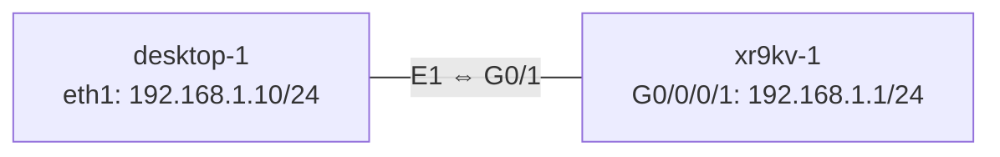
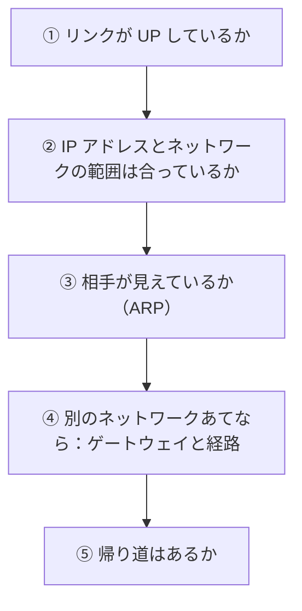

# ping が届かないとき

- 起きた日：2026-10-23（[勉強記録](../study-log/2026-10-23.md)）

## 何が起きたか

XR と Desktop（Linux）をつないだラボで、desktop-1 から、すぐ隣の XR（同じネットワーク 192.168.1.0/24）に ping しても届かなかった。



## 原因

**インターフェースが DOWN になっていた。** IOS XR のインターフェースは、最初はすべて `shutdown` の状態なので、`no shutdown` して `commit` するまで通信できない。

## 切り分けの順番

同じネットワーク内で届かないときは、**経路（ルーティング）ではなく、下の層**に原因がある。下から順に確認する。



### ① リンクが UP しているか

| 機器 | コマンド | 見るところ |
| --- | --- | --- |
| IOS XR | `show ipv4 interface brief` | 対象の IF が `Up  Up` か。`Shutdown` / `Down` なら閉じている |
| Linux | `ip addr show eth1` | `state UP` と `LOWER_UP` があるか。`LOWER_UP` がなければ線がつながっていない |

閉じていたら開ける。

=== "IOS XR"

    ```
    configure
     interface GigabitEthernet0/0/0/1
      no shutdown
     !
    commit
    end
    ```

=== "Linux"

    ```
    sudo ip link set eth1 up
    ```

!!! warning "IOS XR の注意"
    - インターフェースは、最初はすべて `shutdown` になっている
    - `commit` するまで設定が反映されない。`commit` 忘れもよくある原因

### ② IP アドレスとネットワークの範囲は合っているか

- 両側が**同じネットワーク**に入っているか（例：192.168.1.10/24 と 192.168.1.1/24）
- マスク（`/24` や `255.255.255.0`）が両側でそろっているか
- **同じ IP アドレスを2台に付けていないか**

| 機器 | コマンド |
| --- | --- |
| IOS XR | `show ipv4 interface brief`、`show run interface GigabitEthernet0/0/0/1` |
| Linux | `ip addr show eth1` |

!!! note "今回のハマりどころ"
    最初、desktop-1 にゲートウェイ（XR）用の `192.168.1.1` を付けてしまっていた。`sudo ip addr del 192.168.1.1/24 dev eth1` で消して、`.10` を付け直した。

### ③ 相手が見えているか（ARP）

ping を打ったあとに、相手の MAC アドレスが取れているかを見る。

| 機器 | コマンド | 見るところ |
| --- | --- | --- |
| Linux | `ip neigh` | 相手の IP の行に MAC アドレスがあるか。`FAILED` / `INCOMPLETE` なら相手から返事が来ていない |
| IOS XR | `show arp` | 相手の IP と MAC アドレスがあるか |

MAC アドレスが取れていなければ、①②に戻る。

### ④ 別のネットワークあてなら：ゲートウェイと経路

隣ではなく、別のネットワークあてに届かないときに見る。

- **PC（Linux）**：デフォルトゲートウェイがあるか（`ip route` に `default via ...`）。PC は OSPF などで経路を覚えないので、ゲートウェイがないと自分のネットワークの外に出られない
- **ルータ**：宛先への経路があるか（`show route`）

### ⑤ 帰り道はあるか

行きの経路があっても、**返事を返す側に戻りの経路がない**と届かない。たとえば desktop-1 から desktop-0 に ping するときは、desktop-0 にもデフォルトゲートウェイが必要。

## CML 特有の注意：対向が DOWN でも自分は UP に見える

CML では、対向のルータで `shutdown` しても、自分側のインターフェースは `Up  Up` のまま表示される。仮想環境の性質で、仕様。

| | 実機 | CML（仮想環境） |
| --- | --- | --- |
| 対向で `shutdown` したとき | 対向が信号を止めるので、**自分側もリンクダウン** | 仮想の線の信号は止まらないので、**自分側は UP のまま** |

そのため、

- **自分側が UP でも、対向が UP とは限らない。** CML では、①の確認は**両側で**行う
- リンクの障害を再現したいときは、ルータで `shutdown` するのではなく、**CML のリンク（線）を右クリックして Disconnect（Stop）** する。こうすると両側が DOWN になり、実機でケーブルを抜いたときに近い動きになる
- 片側を `shutdown` しただけだと、もう片方は OSPF の Hello が届かなくなって **Dead タイマーが切れるまで（初期値 40秒）**障害に気づかない。TI-LFA や高速収束を試すときは、リンクの Disconnect を使う

## まとめ

- 同じネットワーク内で届かないときは、**① リンクのダウン**と **② IP アドレスの範囲の間違い**をまず確認する
- IOS XR はインターフェースが最初 `shutdown`。`no shutdown` と `commit` を忘れない
- CML では、自分側の UP 表示だけを信じず、**両側**を確認する
