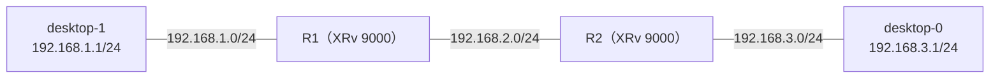

# Desktop を Wipe したあと、ping が通らなくなったとき（古い ARP）

- 起きた日：2026-10-29（演習のあと、Desktop の IP 設定を CONFIG タブに書いたとき）

## 何が起きたか

Desktop の IP 設定を起動時に入るようにするため、desktop-0 と desktop-1 を **Stop → Wipe → CONFIG タブに書く → Start** した。起動後、両方とも IP アドレスとゲートウェイは正しく入っていたのに、**desktop-0 から desktop-1 への ping が通らなかった**。



- desktop-0 から自分のゲートウェイ（R2、192.168.3.2）への ping は通った
- ルータの OSPF の経路も正常だった

## 原因

**R1 の ARP テーブルに、Wipe する前の desktop-1 の MAC アドレスが残っていた。**

```
RP/0/RP0/CPU0:iOS-XR-R1#show arp GigabitEthernet0/0/0/1

Address         Age        Hardware Addr   State      Type  Interface
192.168.1.1     00:03:51   xxxx.xxxx.aaaa  Dynamic    ARPA  GigabitEthernet0/0/0/1   ← Wipe 前の MAC
```

- CML のノードは、Wipe すると **MAC アドレスが変わる**ことがある（ラボの設定で MAC を固定していない場合）
- R1 は、192.168.1.1 宛てのパケットを、古い MAC アドレス宛てに送り続けていた。新しい desktop-1 は受け取らない
- IOS XR の ARP の保持時間は長い（初期値は4時間）ので、自然には直らない

R2 側は、desktop-0 が起動後にゲートウェイ（R2）へ ping したので、ARP が新しい MAC に更新されていた。

## 直し方

R1 の ARP を消して、新しく覚え直させた。

```
RP/0/RP0/CPU0:iOS-XR-R1#clear arp-cache GigabitEthernet0/0/0/1 location 0/0/CPU0
```

消したあと、R1 は desktop-1 の新しい MAC アドレスを覚え直し、ping が通った。

```
Address         Age        Hardware Addr   State      Type  Interface
192.168.1.1     00:00:03   xxxx.xxxx.bbbb  Dynamic    ARPA  GigabitEthernet0/0/0/1   ← 新しい MAC
```

## 確認に使えるコマンド

| どこで | コマンド | 何を見るか |
| --- | --- | --- |
| ルータ（XR） | `show arp <IF>` | 相手の IP に対応する MAC アドレス |
| PC | `ip link show eth1` | 自分の MAC アドレス（`link/ether` の行）。ルータの ARP と見比べる |
| ルータ（XR） | `clear arp-cache <IF> location 0/0/CPU0` | ARP を消して覚え直させる |

## わかったこと

- IP アドレスも経路も正しいのに通らないときは、**L2（ARP と MAC アドレス）**も疑う
- CML でノードを Wipe すると、MAC アドレスが変わることがある。**Wipe したあとは、隣のルータの ARP を消す**と確実
- PC からゲートウェイへ ping すると、ゲートウェイ側の ARP も更新されることが多い
