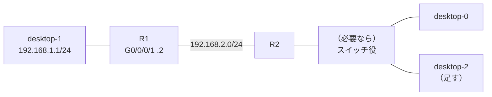

# IP アドレスが重複するとどうなるか

!!! info "検証前（やりたいこと）"
    問いと構成案まで。仮説はこれから書く。進め方は [検証の進め方](../workflow.md) を参照。トラブルシューティング演習の問題としても使う。

- 開始日：2026-11-19（アイデアのメモ）
- きっかけ：トラブルシューティングの練習で、IP アドレスの重複も試したい。以前、desktop-0 に R2 と同じアドレスを付けてしまい、ping が通らなかったことがある

## 問い

**同じネットワークの中で IP アドレスが重複すると、何が起きるのか。どうやって気づけるのか。**

- 重複したとき、ルータや PC にログ（警告）は出るか
- ARP テーブルには、どちらの MAC アドレスが載るか。途中で入れ替わるか
- ping は通るのか、通らないのか、ときどき通るのか
- ルータと PC が重複した場合と、PC 同士が重複した場合で、何が違うか
- ルータ同士のリンク（/30）で重複したら、OSPF のネイバーはどうなるか

## 構成（案）

いつもの OSPF のラボ（R1・R2・desktop-0・desktop-1）を使う。重複させるパターンを変えて試す。

| パターン | 重複させるもの |
| --- | --- |
| A | PC と、その PC のゲートウェイ（ルータの IF）が同じアドレス |
| B | 同じネットワークの PC 同士が同じアドレス（スイッチ役のノードか、ルータの IF に2台つなぐ構成が必要） |
| C | ルータ同士のリンクで、両側に同じアドレス |

## やりたいこと

- [ ] パターン A：PC にゲートウェイと同じアドレスを付けて、PC とルータの両方で何が起きるか見る
- [ ] パターン B：PC を1台足して、PC 同士を重複させる。どちらに ping が届くか、ARP がどう変わるか
- [ ] パターン C：ルータ間のリンクの両側に同じアドレスを付ける。OSPF のネイバー、ログ、経路はどうなるか
- [ ] どのパターンでも、`show logging`、`show arp`、PC の `ip neigh` を見て、**重複に気づける手がかり**を探す
- [ ] 見つけた手がかりを、[OSPF の切り分けの手順](../../troubleshooting/ospf-troubleshooting-flow.md) に足す

## 仮説

（試す前に考えたことを書く）

## 設定

（書く）

## 確認

（書く）

## 結果

（書く）

## 考察

（書く）

## 次の問い

（書く）
