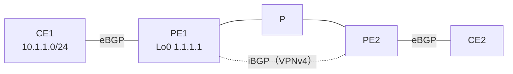

# MPLS L3VPN で、BGP のネクストホップはどうなるのか

!!! info "検証前（やりたいこと）"
    問いと構成案まで。仮説はこれから書く。進め方は [検証の進め方](workflow.md) を参照。

- 開始日：2026-10-27
- 関連：[RT があるのに、なぜ RD が必要なのか](l3vpn-why-rd.md)、[CE から受けた経路が PE の VRF に入るまで](l3vpn-ce-route-to-vrf.md)

## 問い

**CE2 から CE1 宛てのパケットを送るとき、各ルータで BGP のネクストホップと宛先 IP アドレスはどうなっているのか。**

- 区間ごと（CE1→PE1、PE1→PE2、PE2→CE2）に、BGP のネクストホップは何になるか
- PE2 の VRF のルーティングテーブルで、CE1 宛ての経路のネクストホップは何になるか
- パケットの宛先 IP アドレスは、途中で変わるのか
- PE2 は、どうやって PE1 までパケットを運ぶのか（再帰、ラベル）

## 構成（案）

左から CE1、PE1、P、PE2、CE2。CE-PE 間は eBGP、PE-PE 間は iBGP（VPNv4）。途中は MPLS VPN。

| 区間 | 動かすもの |
| --- | --- |
| CE - PE | eBGP（IPv4） |
| PE1 - P - PE2 | IGP（OSPF など）、LDP |
| PE1 - PE2 | iBGP（VPNv4）、ループバック同士 |

!!! note "台数とメモリ"
    PE1・P・PE2 を XRv 9000（20GB × 3 = 60GB）、CE 2台を軽い IOL-XE にすれば、CML 専用機（128GB）に収まる。[RD の検証](l3vpn-why-rd.md) と同じラボで進められる。

## やりたいこと

- [ ] 区間ごとに BGP のネクストホップを確かめる
    - PE1：`show bgp vrf CUST-A 10.1.1.0/24`（CE1 から受けた経路）
    - PE2：`show bgp vpnv4 unicast rd <RD> 10.1.1.0/24`（PE1 から受けた経路）
    - CE2：`show ip bgp 10.1.1.0`（PE2 から受けた経路）
- [ ] PE2 の VRF のルーティングテーブル（`show route vrf CUST-A`）で、10.1.1.0/24 のネクストホップと AD 値を見る。`nexthop in vrf default` の意味を考える
- [ ] PE2 で、そのネクストホップへの経路をグローバルのテーブル（`show route <ネクストホップ>`）で見る。実際にパケットを渡す相手は誰か
- [ ] PE2 で `show cef vrf CUST-A 10.1.1.1` を見て、付けるラベルが何枚で、それぞれ何か
- [ ] パケットの宛先 IP アドレスが途中で変わるか、CML のパケットキャプチャで確かめる（PE2-P 間、P-PE1 間）
- [ ] P で `show mpls forwarding` を見て、P はラベルをどう扱っているか

## 仮説

（試す前に考えたことを書く）

## 設定

（書く）

## 確認

（書く）

## 結果

（書く）

## 考察

（書く）

## 次の問い

（書く）
