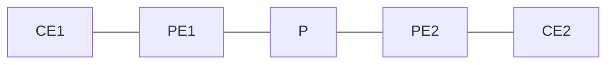
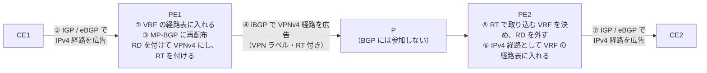

# CE から受けた経路が PE の VRF に入るまで

!!! info "検証前"
    このページは検証を進めながら更新します。進め方は [検証の進め方](workflow.md) を参照。

- 開始日：2026-10-18

## 問い

**MPLS L3VPN で、CE から PE に経路が広報されたとき、PE はどういう順番でその経路を VRF に入れるのか。**

## 仮説

- VRF の設定はインターフェースに入れるので、そのインターフェース（CE 側）から経路が広報されたら、VRF の RT（import）をその経路に付けて、VRF のルーティングテーブルに載せているのではないか

## 想定するラボ構成

CML Free の同時起動5台に収まる構成。

| 区間 | 動かすもの |
| --- | --- |
| CE1 - PE1、PE2 - CE2 | VRF（例：`CUST-A`）、PE-CE 間のルーティング（スタティック / OSPF / eBGP のどれか） |
| PE1 - P - PE2 | IGP（OSPF など）、LDP |
| PE1 - PE2 | iBGP（VPNv4） |

## 参考書での手順（CE1 → PE1 → P → PE2 → CE2）

参考書（図7-8「MPLS VPN 網における経路の伝播」）に載っていた、CE1 の経路が CE2 に届くまでの手順を、自分の言葉でまとめたもの。

| 手順 | どこで | 何をするか |
| --- | --- | --- |
| ① | CE1 → PE1 | CE1 が IGP または eBGP で、IPv4 の経路を PE1 に広告する |
| ② | PE1 | 受け取った IPv4 の経路を、VRF の経路表に入れる |
| ③ | PE1 | VRF の IPv4 経路を MP-BGP に再配布する。このとき RD を付けて VPNv4 の経路にし、RT を付ける |
| ④ | PE1 → PE2 | iBGP で、VPNv4 の経路を MPLS ラベル（VPN ラベル）と RT 付きで PE2 に広告する |
| ⑤ | PE2 | RT を見て取り込む VRF を決め、RD を外す |
| ⑥ | PE2 | IPv4 の経路として、その VRF の経路表に入れる |
| ⑦ | PE2 → CE2 | IGP または eBGP で、IPv4 の経路を CE2 に広告する |

- PE と PE の間の iBGP のパケットは P を通るが、P 自身は BGP に参加しない（P が動かすのは IGP と LDP だけ）
- PE-CE 間が eBGP なら、③ の再配布は不要（BGP のまま VPNv4 にできる）。IGP やスタティックのときは、BGP への再配布の設定が必要

!!! note "自分のメモ"
    - ② の「VRF の経路表に入れる」は、インターフェースに VRF の設定が入っているから、そこから来た経路は VRF に載る、と考えている。PE がどうやって「この VRF の CE から広報された経路」だと判断しているのかを確かめたい
    - RT の import はいつ使うのか。他の PE から届いた経路を受け取るとき（⑤）で、export は自分の経路を送り出すとき（③）なのかを確かめたい

## 小さな問いに分ける

1 回の検証で答えが出るように分けておく。

1. CE から受けた経路は、PE の中でまずどのテーブルに載るか
2. RT（route-target）は、どのタイミングで経路に付くのか。付くのは export か import か
3. PE1 の VRF の RT import を消すと、CE1 から受けた経路は PE1 の VRF に載ったままか
4. PE1 の VRF の RT export を消すと、PE2 にはどう見えるか
5. RD は、どのテーブルで経路に付いているか
6. 入口の PE（PE1）は、CE1 から届いたパケットに何を付けて送り出しているか
7. 出口の PE（PE2）は、届いたパケットがどの VRF のものかを、何を見て判断しているか（VPN ラベルで決まるか）

それぞれ、試す前に仮説を書いておく。

## 確認に使うコマンド

| どこで | コマンド | 何を見るか |
| --- | --- | --- |
| PE1 | `show ip route vrf CUST-A` | VRF のルーティングテーブルに載っているか、どのプロトコルで学んだか |
| PE1 | `show bgp vpnv4 unicast vrf CUST-A` | VPNv4 のテーブルに載っているか、RD は何か |
| PE1 | `show bgp vpnv4 unicast vrf CUST-A <プレフィックス>` | その経路に付いている RT（Extended Community）とラベル |
| PE2 | `show bgp vpnv4 unicast all <プレフィックス>` | PE1 から届いた経路に付いている RD と RT |
| PE2 | `show ip route vrf CUST-A` | import されて VRF に載ったか |
| PE1 / PE2 | `show vrf detail CUST-A` | VRF に設定した RD、RT import / export、所属インターフェース |
| PE1 / PE2 | `show bgp vpnv4 unicast all labels` | 経路ごとに割り当てた VPN ラベル（In / Out） |
| PE1 | `show ip cef vrf CUST-A <宛先> detail` | 宛先に送るときに付けるラベル（ラベルの積み重なり） |
| PE2 | `show mpls forwarding-table` | 届いたラベルをどう処理するか（どの VRF に渡すか） |
| CE1 または PE1 | `traceroute vrf CUST-A <宛先>`（PE1 の場合） | 途中のルータで付いているラベル |

!!! tip "見比べるポイント"
    同じプレフィックスを、**PE1 の VRF のテーブル → PE1 の VPNv4 のテーブル → PE2 の VPNv4 のテーブル → PE2 の VRF のテーブル** の順に追いかけて、それぞれで「RD が付いているか」「RT が付いているか」を表にまとめると、順番が見えてくる。

    問い6・7は、**経路**ではなく**パケット**を追いかける。PE1 で付けたラベルと、PE2 の `show mpls forwarding-table` のラベルを突き合わせると、PE2 がどう判断しているかが見えてくる。

## 設定

（PE1 / PE2 の VRF、MP-BGP の設定をここに書く）

## 確認

（確認コマンドの出力をここに貼る）

## 結果

（何が起きたか、仮説どおりだったか）

## 考察

（なぜその順番になるのか）
