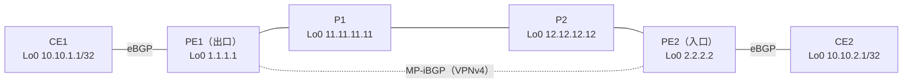

# MPLS VPN を通るパケットの一生（経路とラベルの広報）

!!! info "検証前（やりたいこと）"
    問いと構成案まで。仮説はこれから書く。進め方は [検証の進め方](workflow.md) を参照。

- 開始日：2026-10-28
- きっかけ：参考書『[MPLS Fundamentals](../articles/books.md)』第7章 図7-17「Life of an IPv4 Packet Across the MPLS VPN Backbone: Route and Label Advertisement」を、自分の環境で組んで確かめたい
- 関連：[MPLS L3VPN で、BGP のネクストホップはどうなるのか](l3vpn-bgp-nexthop.md)、[RT があるのに、なぜ RD が必要なのか](l3vpn-why-rd.md)

## 問い

**MPLS VPN で、お客さまの経路・PE のループバック・ラベルは、それぞれどのプロトコルで、どこからどこへ広報されるのか。それを使って、パケットはどう運ばれるのか。**

- お客さまの経路（CE1 のループバック）は、どこからどこへ、どのプロトコルで広報されるか
- PE のループバック（BGP のネクストホップ）は、どこからどこへ、どのプロトコルで広報されるか
- PE のループバックに対するラベルは、ルータごとにいくつになるか
- CE2 から CE1 へのパケットには、各区間でどんなラベルが付いているか

## 構成（案）

参考書の図と同じく、P を2台にする。パケットは **CE2 → CE1**（右から左）、経路の広報はその逆向き。

| 区間 | ネットワーク | 動かすもの |
| --- | --- | --- |
| CE1 - PE1 | 172.16.1.0/30 | eBGP（VRF CUST-A） |
| PE1 - P1 | 10.0.11.0/30 | OSPF、LDP |
| P1 - P2 | 10.0.12.0/30 | OSPF、LDP |
| P2 - PE2 | 10.0.22.0/30 | OSPF、LDP |
| PE2 - CE2 | 172.16.2.0/30 | eBGP（VRF CUST-A） |
| PE1 - PE2 | ループバック同士 | MP-iBGP（VPNv4） |

| VRF | RD | RT |
| --- | --- | --- |
| CUST-A | 65000:1 | 65000:1 |

!!! note "台数とメモリ"
    PE1・P1・P2・PE2 を XRv 9000 にすると 20GB × 4 = 80GB。CE 2台を IOL-XE にすれば、CML 専用機（128GB）に収まる。P は XRd にして軽くしてもよい（転送できるかは要確認）。

## やりたいこと

### 経路の広報

- [ ] **お客さまの経路**：CE1 の 10.10.1.1/32 が、CE1 → PE1 → PE2 → CE2 と届くことを確かめる。P1・P2 はこの経路を知っているか（`show route 10.10.1.1` を P で打つ）
- [ ] **VPNv4 の経路**：PE2 で `show bgp vpnv4 unicast rd 65000:1 10.10.1.1/32` を見て、ネクストホップと VPN ラベル（参考書の図では「Label 30」にあたるもの）を確かめる
- [ ] **PE のループバック**：PE1 の 1.1.1.1/32 が、OSPF で P1 → P2 → PE2 に広報されていることを確かめる（`show route 1.1.1.1` を各ルータで）

### ラベルの広報

- [ ] **LDP のラベル**：1.1.1.1/32 に対して、各ルータが隣に教えているラベルを確かめる（`show mpls ldp bindings 1.1.1.1/32`）。PE1 が P1 に教えるラベルは何か（参考書の図では implicit-null）
- [ ] 各ルータの `show mpls forwarding` で、ラベルの付け替え（入ってくるラベル → 出ていくラベル）を表にする

### パケットの流れ

- [ ] PE2 で `show cef vrf CUST-A 10.10.1.1` を見て、付けるラベルが何枚で、それぞれ何か
- [ ] CE2 から `ping 10.10.1.1 source Loopback0` を打ち、CML のパケットキャプチャで各区間（PE2-P2、P2-P1、P1-PE1）のラベルを見る
- [ ] CE2 から `traceroute 10.10.1.1` を打ち、表示にラベルが出るか、P は表示されるかを見る
- [ ] 参考書の図と同じ形の表を、自分の環境の値で作る

| 場所 | パケット（ラベル） | 何をしたか |
| --- | --- | --- |
| PE2 → P2 | （書く） | （書く） |
| P2 → P1 | （書く） | （書く） |
| P1 → PE1 | （書く） | （書く） |
| PE1 → CE1 | （書く） | （書く） |

## 仮説

（試す前に考えたことを書く）

## 設定

（書く）

## 確認

（書く）

## 結果

（書く）

## 考察

（書く）

## 次の問い

（書く）
