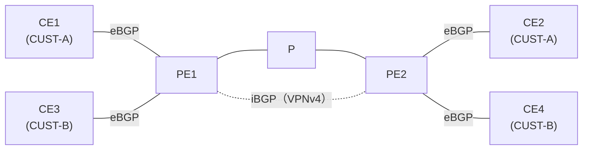

# RT があるのに、なぜ RD が必要なのか

!!! info "検証前（やりたいこと）"
    問いと構成案まで。仮説はこれから書く。進め方は [検証の進め方](workflow.md) を参照。

- 開始日：2026-10-27
- 関連：[CE から受けた経路が PE の VRF に入るまで](l3vpn-ce-route-to-vrf.md)
- 調べてわかったこと：[勉強記録 2026-10-27](../study-log/2026-10-27.md)

## 問い

**MPLS L3VPN で、PE は RT でどの VRF に入れるかを決めているのに、なぜ RD も設定する必要があるのか。**

- RT だけで IPv4 の経路は分けられるのではないか
- RD を設定しないと、何が起きるのか

## 構成（案）

CE-PE 間は eBGP、PE-PE 間は iBGP（VPNv4）で経路を広報する。RD の意味を確かめるため、**同じアドレスを使うお客さまを2つ**（CUST-A と CUST-B）用意する。

| 区間 | 動かすもの |
| --- | --- |
| CE - PE | eBGP（IPv4） |
| PE1 - P - PE2 | IGP（OSPF など）、LDP |
| PE1 - PE2 | iBGP（VPNv4） |

| お客さま | VRF | CE1・CE3 が広報するアドレス |
| --- | --- | --- |
| CUST-A | CUST-A | 10.0.0.0/24（CE1） |
| CUST-B | CUST-B | **10.0.0.0/24**（CE3、CUST-A と同じアドレス） |

!!! note "台数とメモリ"
    PE1・P・PE2 を XRv 9000（20GB × 3 = 60GB）、CE 4台を軽い IOL-XE にすれば、CML 専用機（128GB）に収まる。

## やりたいこと

- [ ] RD と RT をきちんと設定した状態で、PE2 の CUST-A と CUST-B に、それぞれ正しい 10.0.0.0/24 が入ることを確かめる
- [ ] PE1 の VPNv4 テーブル（`show bgp vpnv4 unicast`）で、同じ 10.0.0.0/24 がどう書かれているかを見る
- [ ] CUST-A と CUST-B の **RD を同じ値**にしたら、PE2 の VRF に入る経路はどうなるか
- [ ] RD を設定しないと、VRF の経路は VPNv4 になるか（IOS XR で設定できるか、何が表示されるか）

## 仮説

（試す前に考えたことを書く）

## 設定

（書く）

## 確認

（書く）

## 結果

（書く）

## 考察

（書く）

## 次の問い

（書く）
