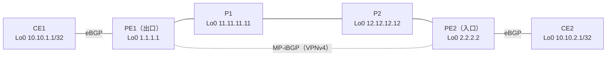

# MPLS VPN を通るパケットの一生（経路とラベルの広報）

!!! info "検証前（やりたいこと）"
    問いと構成案まで。仮説はこれから書く。進め方は [検証の進め方](../workflow.md) を参照。

- 開始日：2026-10-28
- きっかけ：参考書『[MPLS Fundamentals](../../articles/books.md)』第7章 図7-17「Life of an IPv4 Packet Across the MPLS VPN Backbone: Route and Label Advertisement」を、自分の環境で組んで確かめたい
- 調べてわかったこと：[勉強記録 2026-10-28](../../study-log/2026-10-28.md)
- 関連：[MPLS L3VPN で、BGP のネクストホップはどうなるのか](bgp-nexthop.md)、[RT があるのに、なぜ RD が必要なのか](why-rd.md)

## 問い

**MPLS VPN で、お客さまの経路・PE のループバック・ラベルは、それぞれどのプロトコルで、どこからどこへ広報されるのか。それを使って、パケットはどう運ばれるのか。**

- お客さまの経路（CE1 のループバック）は、どこからどこへ、どのプロトコルで広報されるか
- PE のループバック（BGP のネクストホップ）は、どこからどこへ、どのプロトコルで広報されるか
- PE のループバックに対するラベルは、ルータごとにいくつになるか
- CE2 から CE1 へのパケットには、各区間でどんなラベルが付いているか
- **VPN ラベル**は、誰が決めて、何で相手の PE に知らせるのか。VRF の設定値（名前・RD・RT）と関係はあるのか
- PE1 の VRF を、PE2 はどうやって自分の VRF に取り込むのか（VRF の名前は相手に伝わるのか）

## 構成（案）

参考書の図と同じく、P を2台にする。パケットは **CE2 → CE1**（右から左）、経路の広報はその逆向き。

| 区間 | ネットワーク | 動かすもの |
| --- | --- | --- |
| CE1 - PE1 | 172.16.1.0/30 | eBGP（VRF CUST-A） |
| PE1 - P1 | 10.0.11.0/30 | OSPF、LDP |
| P1 - P2 | 10.0.12.0/30 | OSPF、LDP |
| P2 - PE2 | 10.0.22.0/30 | OSPF、LDP |
| PE2 - CE2 | 172.16.2.0/30 | eBGP（VRF CUST-A） |
| PE1 - PE2 | ループバック同士 | MP-iBGP（VPNv4） |

| VRF | RD | RT |
| --- | --- | --- |
| CUST-A | 65000:1 | 65000:1 |

!!! note "台数とメモリ"
    PE1・P1・P2・PE2 を XRv 9000 にすると 20GB × 4 = 80GB。CE 2台を IOL-XE にすれば、CML 専用機（128GB）に収まる。P は XRd にして軽くしてもよい（転送できるかは要確認）。

## やりたいこと

[BGP のネクストホップの検証](bgp-nexthop.md) と同じラボで進められる。ラベルとパケットの流れはこのページで、ネクストホップと再帰はあちらのページで確かめる。

### ① お客さまの経路の広報（MP-iBGP）

- [ ] **お客さまの経路**：CE1 の 10.10.1.1/32 が、CE1 → PE1 → PE2 → CE2 と届くことを確かめる。P1・P2 はこの経路を知っているか（`show route 10.10.1.1` を P で打つ）
- [ ] **RT による取り込み**：PE2 の VRF の**名前を PE1 と変えても**（例：PE1 は CUST-A、PE2 は CUSTOMER-X）、import の RT が一致していれば取り込まれるか。逆に、RT を変えると取り込まれなくなるか
    - PE2：`show bgp vpnv4 unicast rd 65000:1 10.10.1.1/32` で、届いた経路の RT（`Extended community: RT:…`）を見る
    - PE2：`show route vrf <VRF名>` で、その VRF に入ったかを見る

### ② VPN ラベル（MP-iBGP で配る）

- [ ] **PE1 が割り当てたラベル**：PE1 で `show bgp vrf CUST-A labels`。`Local Label` の番号を控える（参考書の図では「Label 30」にあたるもの）
- [ ] **PE2 が受け取ったラベル**：PE2 で `show bgp vpnv4 unicast rd 65000:1 10.10.1.1/32`。受け取ったラベルが、PE1 の `Local Label` と同じ番号か
- [ ] **ラベルと VRF の結びつき**：PE1 で `show mpls label table detail` と `show mpls forwarding labels <番号>`。そのラベルは、どの VRF の、どの宛先（どの CE）に結びついているか
- [ ] **番号と VRF の設定値の関係**：RD や RT を変えると、ラベルの番号は変わるか。VRF をもう1つ作ると、どんな番号が割り当てられるか
- [ ] **割り当て方（label mode）**：CE1 にループバックを2つ作って広報し、ラベルが経路ごとに別か確かめる。`router bgp` の VRF で `label mode per-vrf` にすると、どう変わるか

### ③ PE のループバックと LDP ラベル（PE1 まで運ぶ）

- [ ] **PE のループバック**：PE1 の 1.1.1.1/32 が、OSPF で P1 → P2 → PE2 に広報されていることを確かめる（`show route 1.1.1.1` を各ルータで）
- [ ] **LDP のラベル**：1.1.1.1/32 に対して、各ルータが隣に教えているラベルを確かめる（`show mpls ldp bindings 1.1.1.1/32`）。PE1 が P1 に教えるラベルは何か（参考書の図では implicit-null）
- [ ] 各ルータの `show mpls forwarding` で、ラベルの付け替え（入ってくるラベル → 出ていくラベル）を表にする。P は VPN ラベルを見ているか

### ④ パケットの流れ

- [ ] PE2 で `show cef vrf CUST-A 10.10.1.1` を見て、付けるラベルが何枚で、それぞれ何か（外側は③の LDP ラベル、内側は②の VPN ラベルか）
- [ ] CE2 から `ping 10.10.1.1 source Loopback0` を打ち、CML のパケットキャプチャで各区間（PE2-P2、P2-P1、P1-PE1）のラベルと、**宛先 IP アドレスが途中で変わらないこと**を見る
- [ ] CE2 から `traceroute 10.10.1.1` を打ち、表示にラベルが出るか、P は表示されるかを見る
- [ ] 参考書の図と同じ形の表を、自分の環境の値で作る

| 場所 | パケット（ラベル） | 何をしたか |
| --- | --- | --- |
| PE2 → P2 | （書く） | （書く） |
| P2 → P1 | （書く） | （書く） |
| P1 → PE1 | （書く） | （書く） |
| PE1 → CE1 | （書く） | （書く） |

### 確かめる順番のメモ

| 順番 | どこで | コマンド | 確かめること |
| --- | --- | --- | --- |
| 1 | PE1 | `show bgp vrf CUST-A labels` | 割り当てた VPN ラベルの番号 |
| 2 | PE2 | `show bgp vpnv4 unicast rd … …` | 受け取った番号が 1 と同じか、RT は何か |
| 3 | PE2 | `show cef vrf … …` | パケットに付けるラベル2枚 |
| 4 | PE1 | `show mpls forwarding labels <番号>` | そのラベルが来たら、どの CE に送るか |

## 仮説

（試す前に考えたことを書く）

## 設定

（書く）

## 確認

（書く）

## 結果

（書く）

## 考察

（書く）

## 次の問い

（書く）
