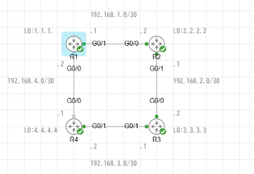

# OSPF で広報される経路

!!! info "検証中"
    このページは検証を進めながら更新しています。進め方は [検証の進め方](../workflow.md) を参照。

- 開始日：2026-10-17（[勉強記録](../../study-log/2026-10-17.md)）

## 問い

**インターフェースで OSPF を有効にしたとき、どんな経路が、どんな形で広報されるのか。**

## 構成

IOSv 4台を四角形につないだ構成。リンクはすべて /30、各ルータにループバック（Lo0）を設定している。

| リンク | ネットワーク | 接続 |
| --- | --- | --- |
| R1 - R2 | 192.168.1.0/30 | R1 G0/1（.1） - R2 G0/0（.2） |
| R2 - R3 | 192.168.2.0/30 | R2 G0/1（.1） - R3 G0/0（.2） |
| R3 - R4 | 192.168.3.0/30 | R3 G0/1（.1） - R4 G0/1（.2） |
| R4 - R1 | 192.168.4.0/30 | R4 G0/0（.1） - R1 G0/0（.2） |

| ルータ | Lo0 |
| --- | --- |
| R1 | 1.1.1.1 |
| R2 | 2.2.2.2 |
| R3 | 3.3.3.3 |
| R4 | 4.4.4.4 |

## 前提（現状）

- IOSv 4台を使用（[勉強記録 2026-10-17](../../study-log/2026-10-17.md)）
- R1 - R4 間のリンクはダウンさせている。R1 - R2 - R3 - R4 の一直線の構成
- 各ルータの物理インターフェースにアドレスを割り当て、ループバック（Lo0）も設定済み
- 物理インターフェースとループバックの両方で OSPF を有効化済み
- ループバックは、OSPF を有効にしないと広報されないことを確認済み

## 仮説

- R2 の G0/1 と R3 の G0/0 のように、P2P リンクの両側で OSPF を有効にすると、ルーティングテーブルに載っている経路（ループバックのアドレス以外）が広報されるのではないか
- 逆に、ある経路を広報しないようにすることもできるのではないか

## 設定

（変更前と変更後の設定をここに書く）

## 確認

（確認コマンドの出力をここに貼る）

## 結果

（何が起きたか、仮説どおりだったか）

## 考察

（なぜその結果になったか）

## 次の問い

- 経路を広報しないようにする方法はあるか
