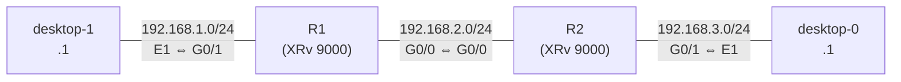

# OSPF をループバックだけで有効にしたとき

!!! info "検証中"
    結果と、ネイバーが張れていないことまでは確認済み。ネイバーが張れない理由はこれから確かめる。進め方は [検証の進め方](../workflow.md) を参照。

- 開始日：2026-10-23（[勉強記録](../../study-log/2026-10-23.md)）
- 関連：[OSPF で広報される経路](advertised-routes.md)（IOSv で、ループバックは OSPF を有効にしないと広報されないことを確認した）

## 問い

**IOS XR で、OSPF をループバックだけで有効にしたとき、ループバックのアドレスは対向のルータに広報されるのか。**

## 構成

CML-Personal（ベアメタル）上の IOS XRv 9000 2台と、PC 役の Desktop 2台。




| リンク | ネットワーク | 接続 |
| --- | --- | --- |
| desktop-1 - R1 | 192.168.1.0/24 | desktop-1 E1（.1） - R1 G0/0/0/1（.2） |
| R1 - R2 | 192.168.2.0/24 | R1 G0/0/0/0（.1） - R2 G0/0/0/0（.2） |
| R2 - desktop-0 | 192.168.3.0/24 | R2 G0/0/0/1（.2） - desktop-0 E1（.1） |

| ルータ | ホスト名 | OSPF ルータ ID | Loopback0 |
| --- | --- | --- | --- |
| R1 | iOS-XR-R1 | 1.1.1.1 | 1.1.1.1/32 |
| R2 | iOS-XR-R2 | 2.2.2.2 | 2.2.2.2/32 |

## 仮説

- OSPF の設定でループバックを有効にすれば、そのループバックのアドレスが対向のルータに広報されるのではないか

## 設定

OSPF は**ループバックだけ**で有効にした。R1 と R2 をつなぐ G0/0/0/0 は、OSPF に入れていない。

=== "R1"

    ```
    RP/0/RP0/CPU0:iOS-XR-R1#show run router ospf
    router ospf 1
     router-id 1.1.1.1
     area 0
      interface Loopback0
      !
     !
    !
    ```

=== "R2"

    ```
    RP/0/RP0/CPU0:iOS-XR-R2#show run router ospf
    router ospf 1
     router-id 2.2.2.2
     area 0
      interface Loopback0
      !
     !
    !
    ```

- 両方とも `area 0` の中に `interface Loopback0` だけが入っている
- ルータ ID は手動で設定（R1 が 1.1.1.1、R2 が 2.2.2.2）

## 確認

| どこで | コマンド | 何を見るか |
| --- | --- | --- |
| R1 / R2 | `show ospf interface brief` | OSPF が有効になっているインターフェース |
| R1 / R2 | `show ospf neighbor` | 対向とネイバーになっているか |
| R1 / R2 | `show route ospf` | 対向のループバックが OSPF の経路（`O`）として載っているか |
| R1 / R2 | `show ospf database` | どんな LSA を持っているか |

R1 での出力（日時の行は省略）。

```
RP/0/RP0/CPU0:iOS-XR-R1#show ospf interface brief

* Indicates MADJ interface, (P) Indicates fast detect hold down state

Interfaces for OSPF 1

Interface          PID   Area            IP Address/Mask    Cost  State Nbrs F/C
Lo0                1     0               1.1.1.1/32         1     LOOP  0/0

RP/0/RP0/CPU0:iOS-XR-R1#show ospf neighbor

RP/0/RP0/CPU0:iOS-XR-R1#show route ospf

% No matching routes found
```

| コマンド | わかったこと |
| --- | --- |
| `show ospf interface brief` | OSPF が有効なのは **Lo0 だけ**。State は `LOOP`、ネイバー数（Nbrs F/C）は `0/0` |
| `show ospf neighbor` | **何も表示されない**。ネイバーが1つもない |
| `show route ospf` | `No matching routes found`。OSPF で学んだ経路が1つもない |

!!! note "`show ospf database` は打ち直す"
    `show ospf detabase` と打ったら `OSPF: No router process database` と出た。綴りが違うため、IOS XR は `detabase` を **OSPF のプロセス名**として読んでしまい、「そんな名前のプロセスはない」と返している。`show ospf database` で打ち直す。

（R2 の出力をここに貼る）

## 結果

- **対向のルータに、ループバックのアドレスは広報されなかった**
- 仮説は外れた

## 考察

- 確認コマンドからわかったことは、**ループバックに OSPF を設定しても、ネイバーが張れていない**ということ
- ネイバーがいないので、ループバックの情報を渡す相手がいない。だから対向に広報されなかったと考えられる

（ネイバーが張れなかった理由は、次の問いで確かめる）

## 次の問い

- R1 と R2 をつなぐ G0/0/0/0 でも OSPF を有効にすると、ループバックは広報されるか
- ループバックのインターフェースは、OSPF の Hello を送っているのか

## 次回のアクション

**物理 IF だけで OSPF を有効にすると、どうなるのか**を試す。今回の構成なら、R1・R2 とも **G0/0/0/0 だけ**で OSPF を有効にする（Loopback0 は OSPF から外す）。

=== "R1"

    ```
    configure
     router ospf 1
      area 0
       no interface Loopback0
       interface GigabitEthernet0/0/0/0
       !
      !
     !
    commit
    end
    ```

=== "R2"

    ```
    configure
     router ospf 1
      area 0
       no interface Loopback0
       interface GigabitEthernet0/0/0/0
       !
      !
     !
    commit
    end
    ```

- 試す前に、仮説（ネイバーは張れるか、何が広報されるか、ループバックは広報されるか）を書いておく
- 確認するコマンドは今回と同じ（`show ospf interface brief`、`show ospf neighbor`、`show route ospf`、`show ospf database`）にして、結果を見比べる
- 今回の結果と比べやすいように、別の検証ページとして記録する → [OSPF を物理 IF だけで有効にしたとき](physical-if-only.md)
