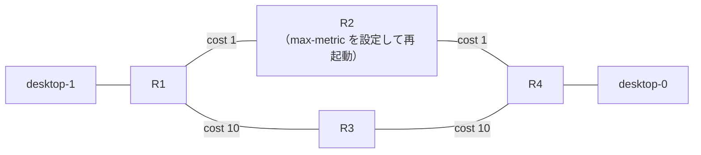

# OSPF の max-metric（起動時にコストを最大にする）

!!! info "検証前"
    問いと構成案まで。仮説はこれから書く。進め方は [検証の進め方](../workflow.md) を参照。

- きっかけ：[勉強記録 2026-10-26](../../study-log/2026-10-26.md)

## 問い

**IOS XR で `max-metric router-lsa on-startup` を設定したルータを再起動すると、Router LSA のコストとトラフィックの通り道はどう変わるのか。**

- 再起動直後、そのルータの Router LSA のコストはいくつになるか
- 周りのルータは、どの経路を選ぶか
- 設定した秒数がたつと、コストと経路は元に戻るか

## CML でどこまで確かめられるか

| 確かめたいこと | CML でできるか |
| --- | --- |
| 再起動後、Router LSA のコストが最大になる | できる（`show ospf database router` で見える） |
| 周りのルータが迂回路を選ぶ | できる（迂回路のある構成にすれば `show route` で見える） |
| 秒数がたつとコストが戻る | できる |
| **RP より先に LC が上がって吸い込みが起きる** | **難しい**。XRv 9000 は1台の仮想マシンで、実機のような RP と LC のカードが別々に起動するしくみがない |

吸い込みそのものは再現できないので、**max-metric の動き（コストと経路の変化）**を確かめる検証にする。

## 構成（案）

迂回路を作るため、XR 4台を四角形につなぐ。R1 → R4 の通常の経路は R2 経由、R3 経由はコストを高くして迂回路にする。**R2** に max-metric を設定して再起動する。

| リンク | ネットワーク | OSPF コスト |
| --- | --- | --- |
| desktop-1 - R1 | 192.168.1.0/24 | — |
| R1 - R2 | 192.168.12.0/24 | 1 |
| R2 - R4 | 192.168.24.0/24 | 1 |
| R1 - R3 | 192.168.13.0/24 | 10 |
| R3 - R4 | 192.168.34.0/24 | 10 |
| R4 - desktop-0 | 192.168.4.0/24 | — |

!!! note "台数とメモリ"
    XRv 9000 は1台 20GB なので、4台で 80GB。CML 専用機（128GB）で動かせる。R3 など経路を中継するだけのルータは、軽い XRd にしてもよい（転送できるかは要確認）。

## 仮説

（試す前に考えたことを書く）

## 設定

（R2 に入れる設定を書く。秒数は、再起動してから確認が間に合う長さにする）

## 確認

| どこで | コマンド | 何を見るか |
| --- | --- | --- |
| R1 | `show ospf database router 2.2.2.2` | R2 の Router LSA の各リンクのコスト（Metrics） |
| R1 | `show route 192.168.4.0/24` | R1 が R4 側へ R2 経由・R3 経由のどちらを選んでいるか |
| R2 | `show ospf` | max-metric が効いている状態か、あと何秒で戻るか |
| desktop-1 | `traceroute 192.168.4.1` | 実際に通っている経路 |

確認は3回行う：**再起動前**、**再起動直後**（max-metric 中）、**設定した秒数がたったあと**。

## 結果

（書く）

## 考察

（書く）

## 次の問い

（書く）
