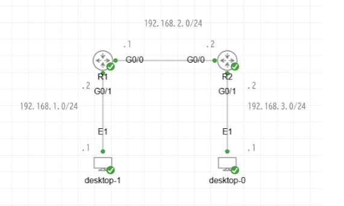

# OSPF を物理 IF だけで有効にしたとき

!!! info "検証中"
    ステップ①は結果と考察まで記録済み。ステップ②はこれから設定する。進め方は [検証の進め方](../workflow.md) を参照。

- 開始日：2026-10-23（[勉強記録](../../study-log/2026-10-23.md)）
- 前の検証：[OSPF をループバックだけで有効にしたとき](loopback-only.md)（ネイバーが張れず、ループバックは広報されなかった）
- 構成・設定・確認コマンドの出力は、CML の MCP サーバーから取得した

## 問い

**IOS XR で、物理 IF に OSPF を設定したとき、どんな経路が広報されるのか。**

2段階で試す。

| ステップ | OSPF を有効にする IF | PC 側（G0/0/0/1） |
| --- | --- | --- |
| ① | R1-R2 間（G0/0/0/0）だけ | 入れない |
| ② | R1-R2 間（G0/0/0/0）＋ PC 向け（G0/0/0/1） | 入れる |

## 構成

前の検証と同じラボ（CML-Personal 上の IOS XRv 9000 2台と Desktop 2台）。



| リンク | ネットワーク | 接続 |
| --- | --- | --- |
| desktop-1 - R1 | 192.168.1.0/24 | desktop-1 eth1（.1） - R1 G0/0/0/1（.2） |
| R1 - R2 | 192.168.2.0/24 | R1 G0/0/0/0（.1） - R2 G0/0/0/0（.2） |
| R2 - desktop-0 | 192.168.3.0/24 | R2 G0/0/0/1（.2） - desktop-0 eth1（.1） |

| ルータ | ノード | OSPF ルータ ID | Loopback0 |
| --- | --- | --- | --- |
| R1 | IOS XRv 9000 26.1.1 | 1.1.1.1 | 1.1.1.1 |
| R2 | IOS XRv 9000 26.1.1 | 2.2.2.2 | 2.2.2.2 |

## 仮説

| ステップ | 仮説 |
| --- | --- |
| ① ルータ間だけ | ネイバーは張れるが、PC 向けの IP アドレス（192.168.1.0/24、192.168.3.0/24）は広報されない |
| ② ルータ間＋PC 向け | ネイバーが張れて、192.168.1.0/24 や 192.168.3.0/24 の経路が広報される |

- 理由はまだわからない（結果を見てから考察で考える）

## ステップ①：ルータ間だけ

### 設定

前の検証から、Loopback0 を OSPF から外し、**G0/0/0/0 だけ**を OSPF に入れた。`network point-to-point` も付けている。

=== "R1"

    ```
    RP/0/RP0/CPU0:iOS-XR-R1#show run router ospf
    router ospf 1
     router-id 1.1.1.1
     area 0
      interface GigabitEthernet0/0/0/0
       network point-to-point
      !
     !
    !
    ```

=== "R2"

    ```
    RP/0/RP0/CPU0:iOS-XR-R2#show run router ospf
    router ospf 1
     router-id 2.2.2.2
     area 0
      interface GigabitEthernet0/0/0/0
       network point-to-point
      !
     !
    !
    ```

### 確認

#### インターフェース

=== "R1"

    ```
    RP/0/RP0/CPU0:iOS-XR-R1#show ipv4 interface brief
    Interface                      IP-Address      Status          Protocol Vrf-Name
    Loopback0                      1.1.1.1         Up              Up       default
    MgmtEth0/RP0/CPU0/0            unassigned      Shutdown        Down     default
    GigabitEthernet0/0/0/0         192.168.2.1     Up              Up       default
    GigabitEthernet0/0/0/1         192.168.1.2     Up              Up       default
    GigabitEthernet0/0/0/2         unassigned      Shutdown        Down     default
    （G0/0/0/3〜8 は unassigned / Shutdown のため省略）
    ```

=== "R2"

    ```
    RP/0/RP0/CPU0:iOS-XR-R2#show ipv4 interface brief
    Interface                      IP-Address      Status          Protocol Vrf-Name
    Loopback0                      2.2.2.2         Up              Up       default
    MgmtEth0/RP0/CPU0/0            unassigned      Shutdown        Down     default
    GigabitEthernet0/0/0/0         192.168.2.2     Up              Up       default
    GigabitEthernet0/0/0/1         192.168.3.2     Up              Up       default
    GigabitEthernet0/0/0/2         unassigned      Shutdown        Down     default
    （G0/0/0/3〜8 は unassigned / Shutdown のため省略）
    ```

#### OSPF

```
RP/0/RP0/CPU0:iOS-XR-R1#show ospf neighbor

Neighbors for OSPF 1

Neighbor ID     Pri   State           Dead Time   Address         Interface
2.2.2.2         1     FULL/  -        00:00:33    192.168.2.2     GigabitEthernet0/0/0/0
    Neighbor is up for 01:01:54

Total neighbor count: 1
```

```
RP/0/RP0/CPU0:iOS-XR-R1#show route ospf

% No matching routes found
```

```
RP/0/RP0/CPU0:iOS-XR-R2#show route ospf

% No matching routes found
```

```
RP/0/RP0/CPU0:iOS-XR-R1#show ospf database

            OSPF Router with ID (1.1.1.1) (Process ID 1)

		Router Link States (Area 0)

Link ID         ADV Router      Age         Seq#       Checksum Link count
1.1.1.1         1.1.1.1         1901        0x80000008 0x0052e1 2
2.2.2.2         2.2.2.2         1899        0x80000008 0x00f13d 2
```

| コマンド | 出力からわかる事実 |
| --- | --- |
| `show ospf neighbor` | R1 は 2.2.2.2（R2）と **FULL** になっている |
| `show route ospf` | R1・R2 とも、OSPF で学んだ経路は**なし** |
| `show ospf database` | Router LSA が 1.1.1.1 と 2.2.2.2 の **2つ**。どちらも Link count は 2 |

## ステップ②：ルータ間＋PC 向け

### 設定

ステップ①の設定に、PC 向けの **G0/0/0/1** を追加する。

=== "R1"

    ```
    configure
     router ospf 1
      area 0
       interface GigabitEthernet0/0/0/1
       !
      !
     !
    commit
    end
    ```

=== "R2"

    ```
    configure
     router ospf 1
      area 0
       interface GigabitEthernet0/0/0/1
       !
      !
     !
    commit
    end
    ```

### 確認

ステップ①と同じコマンドで確認して、見比べる。

| どこで | コマンド | 何を見るか |
| --- | --- | --- |
| R1 / R2 | `show ospf interface brief` | OSPF が有効な IF が増えたか |
| R1 / R2 | `show ospf neighbor` | ネイバーの数・相手は変わったか |
| R1 / R2 | `show route ospf` | 対向の PC 側のネットワークが `O` で載るか |
| R1 / R2 | `show ospf database` | LSA の数・Link count は変わったか |
| desktop-1 | `ping 192.168.3.1` | PC 同士で通信できるか |

（設定後の出力をここに貼る）

## 結果

| ステップ | 何が起きたか | 仮説どおりか |
| --- | --- | --- |
| ① ルータ間だけ | ネイバーは張れた（FULL）が、PC 向けのネットワーク（192.168.1.0/24、192.168.3.0/24）は広報されなかった | 仮説どおり |
| ② ルータ間＋PC 向け | （書く） | （書く） |

## 考察

### ステップ①

- ネイバーは張れているのに、PC 向けのネットワークは広報されていない
- このことから、**OSPF は、OSPF を有効にした IF の経路だけを広報する**のではないかと考えた
- たとえば R1 に PC が複数台つながっていて、PC1 側の IF では OSPF を有効にし、PC2 側の IF では有効にしていない場合、**有効にした PC1 側の IP アドレスの経路だけが広報される**はず

### ステップ②

（書く）

## 次の問い

（考察から出てきた疑問を書く）

## 補足・アドバイス

!!! tip "自分で確かめてみよう"
    答えは書かず、考えるための手がかりと、やってみると良いことを書いています。

### 考察の言葉づかい

- 「OSPF を有効化した **IF から広報された経路** のみを広報する」と書きかけていたので、少し整理しておくと良さそう。OSPF が広報しているのは、**誰かから届いた経路**なのか、**その IF 自身が持っているネットワーク**なのか。R1 の G0/0/0/1 が持っているネットワークは何か、`show ipv4 interface brief` の IP アドレスとマスクから考えてみよう

### やってみよう

1. **地図の中身を見る**：`show ospf database router` で、R1 と R2 の Router LSA に何が書かれているか見てみよう。Link count が 2 の「2つ」は何と何か。ステップ②のあとで、どこが増えるか比べてみよう
2. **ルータ間のネットワークはどう見えるか**：192.168.2.0/24 は OSPF を有効にした IF のネットワークなのに、`show route ospf` には出てこなかった。`show route` （ospf を付けない）で 192.168.2.0/24 が何として載っているか見てみよう。考察の「有効にした IF の経路だけを広報する」と矛盾しないか考えてみよう
3. **PC1・PC2 の例を本当に試す**：考察で書いた例は、そのまま検証できる。R1 の空いている IF（G0/0/0/2 など）に Desktop をもう1台つないで、片方だけ OSPF を有効にしてみよう
4. **PC 側の IF で OSPF を有効にすると、何が起きるか**：ステップ②のあと、PC 側の IF で `show ospf interface GigabitEthernet0/0/0/1` を見てみよう。PC は OSPF をしゃべらないのに、R1 は PC に向けて何かを送っていないか。送っているなら、それは困ることか。`passive` というキーワードを調べてみよう
