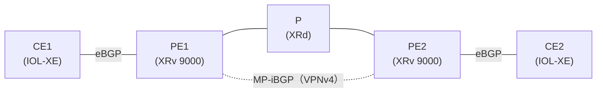

# XRd は P ルータとして動くか

!!! info "検証前（やりたいこと）"
    問いと構成案まで。仮説はこれから書く。進め方は [検証の進め方](../workflow.md) を参照。

- 開始日：2026-10-29
- きっかけ：XRv 9000 は1台 20GB で、CML 専用機（128GB）では5台ほどしか動かせない。P ルータを軽い XRd にできれば、XR の台数を増やせる
- 関連：[MPLS VPN を通るパケットの一生](../l3vpn/packet-life.md)（P を2台使う構成）

## 問い

**CML の IOS XRd（xrd-26-1-1）を、MPLS 網の P ルータとして使えるか。**

- OSPF（または IS-IS）と LDP は、XRv 9000 と同じ設定で動くか
- ラベルを付けたパケットを、正しく付け替えて転送できるか（ping・traceroute が通るか）
- L3VPN の通信（CE 同士）が、XRd の P を通って届くか
- メモリと起動時間は、XRv 9000 と比べてどれくらいか

## わかっていること（調べた範囲）

- XRd には Control Plane 版と vRouter 版がある。Control Plane 版の転送は、シスコのデータシートでは「最小限」とされている
- CML に入っている XRd がどちらの版かは、まだ確かめていない
- MPLS L3VPN の ping は XRd で通るという報告がある一方、L2VPN（疑似回線）の一部では転送がうまくいかなかったという報告もある

## 構成（案）

まずは小さく、P を1台だけ XRd にする。

| ノード | 種類 | 役割 |
| --- | --- | --- |
| PE1・PE2 | XRv 9000 | VRF、MP-iBGP、OSPF、LDP |
| P | **XRd** | OSPF、LDP だけ（BGP なし） |
| CE1・CE2 | IOL-XE | eBGP で PE とつながる |

うまく動いたら、[パケットの一生](../l3vpn/packet-life.md) の構成（P を2台）でも P1・P2 を XRd にする。

## やりたいこと

### ① XRd そのもの

- [ ] XRd を1台置いて起動し、起動にかかる時間と、使うメモリ（CML のノードの RAM）を記録する。XRv 9000 と比べる
- [ ] インターフェースの名前（`show ipv4 interface brief`）と、CML のリンクのつなぎ方を確かめる
- [ ] Control Plane 版か vRouter 版か、確かめる方法を探す（`show version` など）

### ② P としての動作

- [ ] OSPF：PE1・PE2 とネイバーが FULL になるか（`show ospf neighbor`）
- [ ] LDP：PE1・PE2 と LDP のネイバーになるか（`show mpls ldp neighbor`）。PE のループバックにラベルが割り当てられるか（`show mpls ldp bindings`）
- [ ] ラベルの付け替え：`show mpls forwarding` で、PE1・PE2 のループバック宛てのラベルが入っているか
- [ ] PE1 のループバックから PE2 のループバックへ `ping`・`traceroute`。traceroute にラベルが表示されるか

### ③ L3VPN を通す

- [ ] CE1 から CE2 へ `ping`。通るか
- [ ] CML のパケットキャプチャで、P（XRd）の前後のラベルを見る。P で外側のラベルが付け替わり（または外され）、VPN ラベルはそのまま残っているか
- [ ] 大きいパケット（`ping` の size を大きくする）も通るか

### ④ 比べる

- [ ] 同じ構成で、P を XRv 9000 にしたときと結果を比べる（できれば）

| 項目 | XRv 9000 | XRd |
| --- | --- | --- |
| 起動時間 | 10〜15分 | （書く） |
| メモリ | 20GB | （書く） |
| OSPF・LDP | 動く | （書く） |
| ラベルの付け替え | 動く | （書く） |
| L3VPN の ping | 動く | （書く） |

## 仮説

（試す前に考えたことを書く）

## 設定

（書く）

## 確認

（書く）

## 結果

（書く）

## 考察

（書く）

## 次の問い

（書く）
