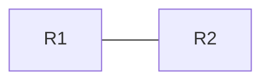

<!--
新しい記事を書くときはこのファイルをコピーして使う。
このフォルダは docs/ の外にあるのでサイトには公開されない。

■ 公開前チェック
[ ] 業務の設定・ホスト名・IPアドレス・社内構成に似たものが入っていない
[ ] CMLのノードイメージ等のファイルを添付していない（コンフィグ・show出力・図はOK）
[ ] show出力にシリアル番号やライセンス情報が入っていない
-->

# タイトル

!!! info "この記事の環境"
    - 検証環境: CML（ノード構成）
    - 前提: （IGPなど）

## ゴール

-

## トポロジ



## 設定

```text
```

## 確認

```text
```

## わざと壊してみる

## ハマったポイント

## まとめ
